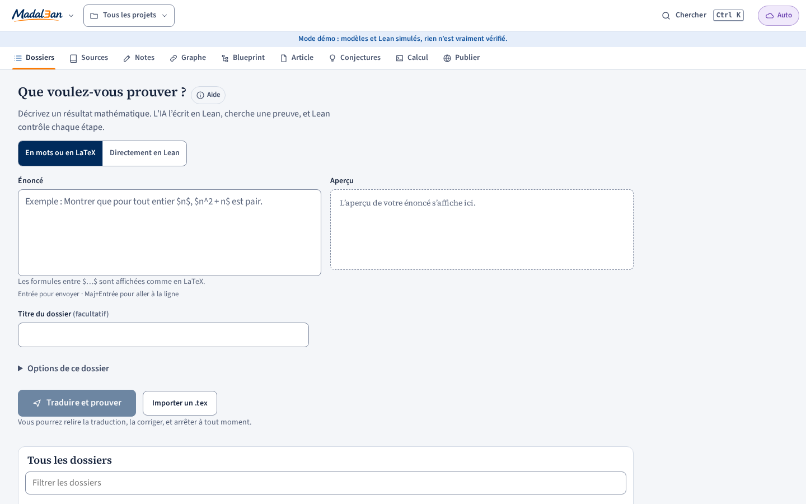
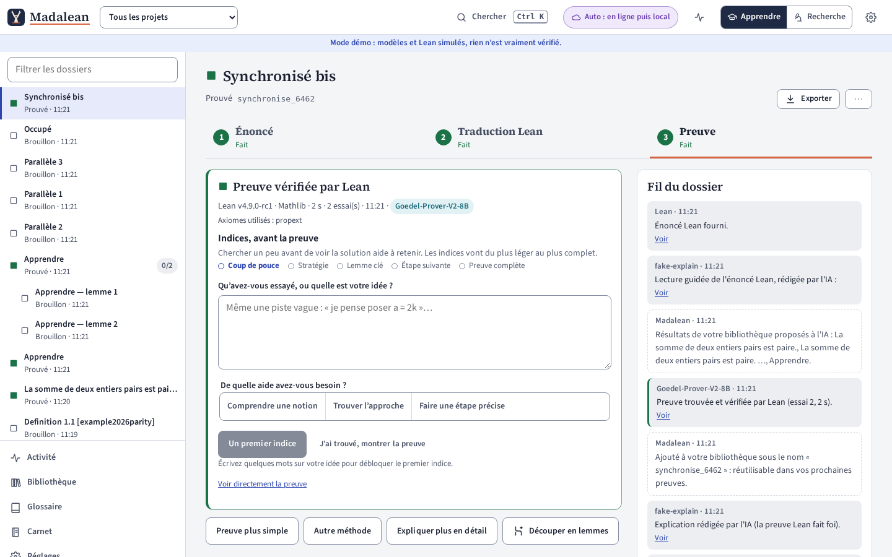
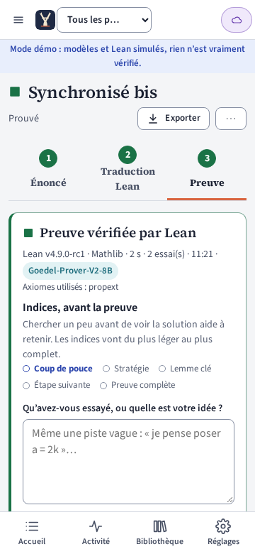

<p align="center">
  <picture>
    <source media="(prefers-color-scheme: dark)" srcset="docs/brand/madalean-wordmark-dark.svg">
    
  </picture>
</p>

# Madalean

*[Version française](README.md)*

**Write a mathematical statement in your own words or in LaTeX. Madalean translates it into Lean, looks for a proof,
and Lean checks it. Around the proof: notes, conjectures, Sage computations, sources, a LaTeX article and a published
site.**



## What is it for?

* **Lean** checks a proof line by line: when Lean says "correct", the proof is correct. But statements and proofs
  must be written in a very precise language.
* **Madalean hands that writing to AI models** and lets Lean judge the result. A proof is marked "verified" only if
  Lean accepted it, without `sorry` (unfinished proof) and without added axioms.
* **Before proving, Madalean checks the statement**: it says whether the translation is faithful, doubtful or wrong,
  and can show a counterexample. It also looks first for the result in Mathlib.
* **For a hard result**, Madalean proposes a split into lemmas as a map: you approve the plan, each lemma is proved,
  then everything is combined.



## What 2.0 contains

| Space | What for |
|---|---|
| **Proofs** | statement → Lean → verified proof → plain-language explanation; follow-ups ("add the hypothesis…", "shorter proof"); every version kept |
| **Proof plan** | split into lemmas as a mind map, automatic proofs, recombination |
| **Calcul** | SageMath notebook (cells, plots, dynamic geometry), natural-language requests, same notebook as JupyterLab |
| **Notes and conjectures** | notes with checkable Lean blocks, conjectures linked to computations and proofs |
| **Sources** | PDF and arXiv reading, questions about a paper, bibliography |
| **Article** | visual LaTeX editor (formulas, theorems, figures, citations), source in one click, PDF preview, assistant as suggestions, Overleaf exchange |
| **Publish** | static site of the project (re-checkable proofs, computations, article) on GitHub Pages |
| **Library and glossary** | proved results filed by field and reused as lemmas; glossary by category and level |

## Models

* **Online first**: the best free models of the moment (Gemini, Mistral, Groq, Cerebras, NVIDIA, OpenRouter…)
  compete in a tournament, led by **Goedel-Prover-V2-32B** through Hugging Face (your key). Paid models (e.g. Claude)
  are only reinforcements, with per-proof and monthly caps you set.
* **Automatic rankings**: Settings › Models shows, per field, the models that really succeeded here, the public
  LMArena ranking and model news. It refreshes on its own.
* **Offline**: local models (Goedel-Prover, Qwen) run on the computer's graphics card.
* **Your keys stay with you**: they are kept on the host computer and sent only to their provider.

## One computer, all your devices

Madalean is installed on **one Linux computer** (the host), which does all the work. Your phone, tablet or another
PC connect to it through your private **Tailscale** network:

* **Android**: the Madalean app. On the host, open Settings › Devices › "Add a device", then in the app tap
  "Scan the QR code".
* **Another Linux PC**: the AppImage.
* **iPhone, iPad, others**: a browser is enough.

Screens adapt to phones and tablets.



## Install

**Madalean 2.0.0 is released.** Site, complete installation guide and manual: <https://raantss18.github.io/madalean/>.

Linux x86_64; about 6 GB without a local model, 25 GB with. An NVIDIA card with at least 8 GB enables local models;
without one, everything works with online models.

**Easiest: the graphical installer** `Madalean-installer.run` (from the next release on; the link always leads to the
latest): <https://github.com/raantss18/madalean/releases/latest/download/Madalean-installer.run>. Make it executable
(right-click › Properties › “Allow executing”, or `chmod +x Madalean-installer.run`) and double-click it: it checks
its integrity, examines the machine (graphics card, memory, SageMath, TeX Live, Python, Lean, Ollama, Tailscale
already present), proposes a plan (reuse or install each tool, local model recommended or not) and shows the
installation live in your browser.

**From source**, the same assistant in the terminal:

```bash
git clone https://github.com/raantss18/madalean.git ~/madalean
cd ~/madalean
./install.sh            # assistant: machine table, recommended plan, every choice can be changed
./install.sh --yes      # no question (defaults)
./install.sh --dry-run  # shows the plan, installs nothing
```

Everything goes into one folder (Lean and Mathlib, SageMath on demand or the system's, LaTeX, the model engine, a
Tailscale node), without `sudo` or system packages: when a system package would help (bubblewrap), the exact command
is printed for you to run. It can be re-run safely. Madalean then starts with the computer; open it from the menu or
at `http://127.0.0.1:11500`. To uninstall: `./uninstall.sh` (your settings and projects are kept).

Details: [installation guide](https://raantss18.github.io/madalean/en/install.html), [docs/INSTALL.md](docs/INSTALL.md)
and the [manual](docs/manual/en/index.md).

## Updates

Madalean updates itself from Settings › Updates. Every release is signed, and a badly signed update is refused.
Lean, Mathlib, SageMath and LaTeX are tracked too: they are installed next to the old version, checked, then Madalean
switches over. Your proofs are then re-checked.

## Security

* Nobody outside your Tailscale network can reach Madalean, and each device must be linked with a code.
* Lean code, LaTeX and computations run isolated (no network, no access to your files).
* Independent security review: [docs/SECURITY.md](docs/SECURITY.md).

## Author

RANIRIAMANJAKA Antsa — [antsa.raniriamanjaka@univ-antananarivo.mg](mailto:antsa.raniriamanjaka@univ-antananarivo.mg)
— [github.com/raantss18](https://github.com/raantss18)

Apache-2.0 licence. Current version: 2.0.0. Lean, Mathlib, SageMath, the models and the other components keep their own licenses.
The former 1.x application ("Lean AI Station") is described in [CHANGELOG.md](CHANGELOG.md).
