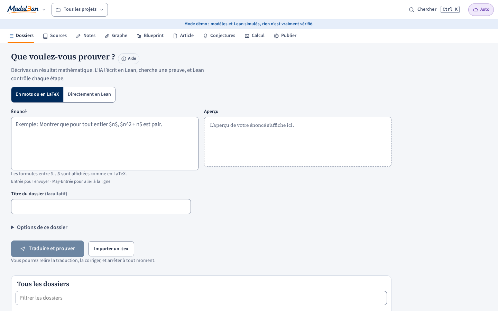
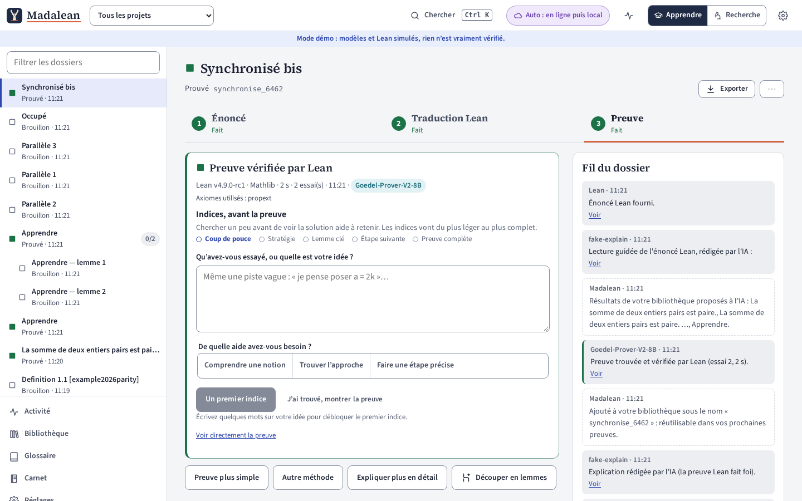
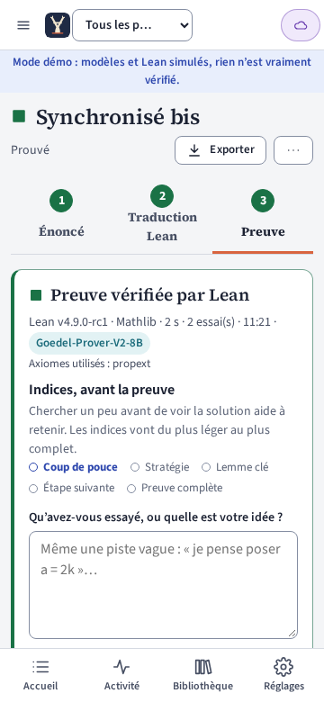

# Madalean

*[English version](README.en.md)*

**Vous écrivez un énoncé de mathématiques avec vos mots ou en LaTeX. Madalean le traduit en Lean, cherche une preuve,
et Lean la vérifie. Autour de la preuve : notes, conjectures, calculs Sage, sources, article LaTeX et site publié.**



## À quoi ça sert ?

* **Lean** vérifie une preuve ligne par ligne : quand Lean dit « correct », la preuve est correcte. Mais il faut lui
  écrire les énoncés et les preuves dans un langage très précis.
* **Madalean confie cette écriture à des IA** et fait juger le résultat par Lean. Une preuve n'est marquée
  « vérifiée » que si Lean l'a acceptée, sans `sorry` (preuve à compléter) et sans axiome ajouté.
* **Avant de prouver, Madalean vérifie l'énoncé** : il dit si la traduction est fidèle, douteuse ou fausse, et peut
  montrer un contre-exemple. Il cherche aussi d'abord si le résultat existe déjà dans Mathlib.
* **Pour un résultat difficile**, Madalean propose un découpage en lemmes sous forme de carte : vous validez le plan,
  chaque lemme est prouvé, puis tout est recombiné.



## Ce que contient la 2.0

| Espace | Pour quoi faire |
|---|---|
| **Preuves** | énoncé → Lean → preuve vérifiée → explication en français ; demandes de suivi (« ajoute l'hypothèse… », « preuve plus courte ») ; versions gardées |
| **Plan de preuve** | découpage en lemmes en carte mentale, preuves automatiques, recombinaison |
| **Calcul** | carnet SageMath (cellules, courbes, géométrie dynamique), demandes en langage naturel, même carnet que JupyterLab |
| **Notes et conjectures** | notes avec blocs Lean vérifiables, conjectures reliées aux calculs et aux preuves |
| **Sources** | lecture de PDF et d'articles arXiv, questions sur un article, bibliographie |
| **Article** | éditeur LaTeX visuel (formules, théorèmes, figures, citations), source à un clic, aperçu PDF, assistant en suggestions, échange avec Overleaf |
| **Publier** | site statique du projet (preuves revérifiables, calculs, article) sur GitHub Pages |
| **Bibliothèque et glossaire** | résultats prouvés rangés par domaine et réutilisés comme lemmes ; glossaire par catégories et niveaux |

## Les modèles

* **En ligne d'abord** : les meilleurs modèles gratuits du moment (Gemini, Mistral, Groq, Cerebras, NVIDIA,
  OpenRouter…) s'affrontent en tournoi, avec en tête **Goedel-Prover-V2-32B** via Hugging Face (votre clé).
  Les modèles payants (par exemple Claude) ne servent qu'en renfort, avec des plafonds par preuve et par mois que
  vous réglez.
* **Classement automatique** : Réglages › Modèles montre, par domaine, les modèles qui ont vraiment réussi ici,
  le classement public LMArena et les nouveautés. Il se met à jour tout seul.
* **Hors connexion** : des modèles locaux (Goedel-Prover, Qwen) tournent sur la carte graphique de l'ordinateur.
* **Vos clés restent chez vous** : elles sont gardées sur l'ordinateur hôte et envoyées seulement à leur fournisseur.

## Un ordinateur, tous vos appareils

Madalean s'installe sur **un ordinateur Linux** (l'hôte), qui fait tout le travail. Le téléphone, la tablette ou un
autre PC s'y relient par votre réseau privé **Tailscale** :

* **Android** : l'application Madalean. Sur l'hôte, ouvrez Réglages › Appareils › « Ajouter un appareil », puis
  dans l'application, touchez « Scanner le QR code ».
* **Autre PC Linux** : l'AppImage.
* **iPhone, iPad, autres** : un navigateur suffit.

Les écrans s'adaptent au téléphone et à la tablette.



## Installer

Linux x86_64, environ 40 Go de disque. Une carte NVIDIA est conseillée pour les modèles locaux (sans elle, tout
marche en ligne, et hors connexion sur le processeur, plus lentement).

```bash
git clone https://github.com/raantss18/madalean.git ~/madalean
cd ~/madalean
./install.sh
```

Le script installe tout dans un seul dossier (Lean et Mathlib, SageMath à la demande, LaTeX, moteur des modèles,
nœud Tailscale), sans `sudo` ni paquet système. Il peut être relancé sans risque. Madalean démarre ensuite tout seul
avec l'ordinateur ; on l'ouvre depuis le menu des applications ou à l'adresse `http://127.0.0.1:11500`. Pour désinstaller : `./uninstall.sh` (vos
réglages et vos projets sont gardés).

Détails : [docs/INSTALL.md](docs/INSTALL.md) et le [manuel](docs/manual/fr/index.md).

## Mises à jour

Madalean se met à jour depuis Réglages › Mises à jour. Chaque version est signée, et une mise à jour mal signée est
refusée. Lean, Mathlib, SageMath et LaTeX sont suivis eux aussi : ils s'installent à côté de l'ancienne version, sont
vérifiés, puis Madalean bascule sur la nouvelle. Vos preuves sont ensuite revérifiées.

## Sécurité

* Personne d'extérieur à votre réseau Tailscale ne peut joindre Madalean, et chaque appareil doit être relié par un code.
* Le code Lean, LaTeX et les calculs tournent isolés (sans réseau, sans accès à vos fichiers).
* Revue de sécurité indépendante : [docs/SECURITY.md](docs/SECURITY.md).

## Auteur

RANIRIAMANJAKA Antsa — [antsa.raniriamanjaka@univ-antananarivo.mg](mailto:antsa.raniriamanjaka@univ-antananarivo.mg)
— [github.com/raantss18](https://github.com/raantss18)

Licence Apache 2.0. Lean, Mathlib, SageMath, les modèles et les autres composants gardent leurs propres licences.
L'ancienne application 1.x (« Lean AI Station ») est décrite dans [CHANGELOG.md](CHANGELOG.md).
