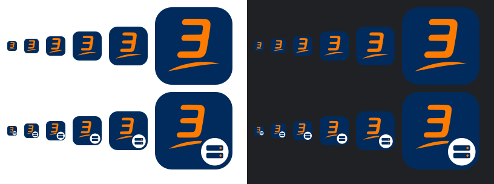

# Madalean — visual identity (D40)

The logo is the user's « Madal∃an »: a rounded hand-lettered script in navy, the « e » replaced by an orange
upright **∃** (there exists — Lean's existential quantifier), an orange swoosh under the whole word.

## Colours

| Name | Hex | Use |
|---|---|---|
| Navy | `#002B5C` | the script, app icon background, primary buttons (`--ink` light), Android splash / launcher background |
| Orange | `#FE7B01` | the ∃ and the swoosh; in the UI only fills and decoration (`--laterite-mark`, `--brand-orange`) |
| Dark orange (text) | `#A84B00` light theme · `#FF9A3D` dark theme | orange **text** (`--laterite`) |
| White | `#FFFFFF` | the script on dark backgrounds (`madalean-wordmark-dark.svg`) |

Contrast (WCAG 2.x ratios, computed with the relative-luminance formula):

| Pair | Ratio | Verdict |
|---|---|---|
| navy on white | 14.0:1 | any text |
| white on navy (primary button label) | 14.0:1 | any text |
| **orange on white** | **2.6:1** | **never for text or thin icons**; fills, rules, underlines, highlight outlines only |
| white on orange | 2.6:1 | never (no white label on an orange button) |
| navy on orange / orange on navy | 5.4:1 | text OK: label of an orange button is navy; the orange ∃ on the navy icon |
| dark orange `#A84B00` on white / on `--bg` `#F4F6F9` | 5.7:1 / 5.3:1 | AA text |
| orange `#FE7B01` on dark surface `#111B2E` | 6.6:1 | AA text in the dark theme |
| `#FF9A3D` on dark surface `#111B2E` | 8.2:1 | orange text, dark theme |
| link blue `#0B4F9C` on white / `#8DB8F2` on `#111B2E` | 8.0:1 / 8.4:1 | links, focus |

The UI themes (`web/src/styles/tokens.css`, mirrored in `site/assets/style.css`) keep their token names; the full table
with every pair is in docs/UI.md §3. Dark theme: navy-tinted surfaces (`#0B1220` / `#111B2E` / `#18243A`), white
script, orange kept.

## Files

One master, everything else generated by `scripts/build_brand.py` (needs `rsvg-convert`, ImageMagick; `potrace` to
re-trace). Never edit a generated file by hand: change the master or the script and run it again.

| File | What |
|---|---|
| `shells/branding/madalean-logo-source.png` | the original raster (2172 × 724) |
| `shells/branding/madalean-wordmark.svg` | **master**: three paths (`script`, `exists`, `swoosh`) traced with potrace (`build_brand.py --trace …`) |
| `madalean-wordmark-dark.svg` / `-mono.svg` | white script for dark backgrounds / one colour (`currentColor`) |
| `madalean-icon.svg` | app icon: the traced ∃ + a redrawn swoosh, orange on a navy rounded square |
| `madalean-icon-small.svg` | ≤ 32 px variant: bigger ∃, heavier swoosh (used for 16/24/32 px and the favicon) |
| `madalean-icon-maskable.svg` / `-round.svg` | full-bleed (PWA maskable, Apple touch) / circle (Android round) |
| `madalean-mark-mono.svg` | ∃ + swoosh, one colour, no background |
| `madalean-server-icon.svg` / `-small.svg` | « Madalean Server » (the host's app, D50): the app icon with a server badge; ≤ 32 px variant |
| `png/` | icon 16 → 1024, server icon 16 → 1024 (RGBA), maskable 512, mono mark, wordmarks 1300 px |
| `web/public/brand/` | `icon.svg`, `favicon.ico` (16/32/48), `icon-{32,192,256,512}.png`, `icon-maskable-512.png`, `apple-touch-icon.png`, `wordmark(-dark).svg`, `mark-mono.svg`; `web/public/manifest.webmanifest` |
| Android | `res/drawable/ic_launcher_{foreground,monochrome}.xml` (adaptive + themed icon, also the splash icon), `mipmap-*/ic_launcher(_round).png`, navy `ic_launcher_background` / `splash_background` |
| Desktop | `shells/desktop/src-tauri/icons/*` (AppImage; all RGBA, as tauri requires), `server-{32x32,128x128}.png` (host mode: tray, window), `shells/desktop/ui/icon.svg`, `ui/server-icon.svg`; `install_desktop_entry.sh` (client) installs `madalean-icon.svg` and `png/madalean-icon-{48,128,256,512}.png` as `madalean`; `install_host_app.sh` (host) installs `madalean-server-icon.svg` and `png/madalean-server-icon-{16…512}.png` as `madalean-server` |
| `docs/brand/icons-client-server.png` | the two icons side by side (below) |
| `docs/brand/` | wordmarks for the READMEs; the site (`site/build.py`) copies the files of `web/public/brand/` |

## Usage rules

- Wordmark on light backgrounds: `madalean-wordmark.svg`; on dark or navy: `-dark.svg`; one-colour print or
  embossing: `-mono.svg`. Keep clear space of at least the ∃'s width around it; minimum height 24 px on screen.
- Icon below 48 px: the plain app icon (never the wordmark). Never recolour the ∃ in navy on navy, never put the
  orange ∃ on white without the navy square (2.6:1).
- In the UI, orange is an accent: one or two touches per screen (brand rule, current step underline, highlight
  outline, a tour card's top border). Body text, links and focus stay navy / blue.
- App name stays « Madalean » in text (the ∃ is a logo device, not a spelling: screen readers read « Madalean »).

## Client and server icons (D50)

Two apps carry the icon, and both can sit in the same menu on the host:

| App | Where | Icon | Menu name |
|---|---|---|---|
| **Madalean** — the client | other PCs (AppImage), phones and tablets (APK), the browser (PWA / favicon) | the app icon, unchanged | « Madalean » |
| **Madalean Server** — the host's own app | the host only (installed by install.sh / the `.run`) | the same icon + a **server badge** | « Madalean Server » |

The badge: a white disc with a navy ring in the bottom-right corner, holding two navy rack units (with two small
orange LEDs from 48 px). The ∃ and the swoosh are scaled down (× 0.84, × 0.80 at ≤ 32 px) towards the top-left so the
badge never covers the ∃; it overlaps only the swoosh's right tip. Why this mark: the family stays obvious (same navy
square, same orange ∃ and swoosh), and the difference is one shape in one place — a white dot at 16 px, a readable
server from 32 px. White on navy is 14:1 and the navy ring separates the disc from light panels and from the orange;
on dark panels the white disc is the brightest spot of the icon. Rejected: recolouring the swoosh or the ∃ (too
subtle below 32 px, and orange/white contrast is 2.6:1), an orange badge (merges with the swoosh), a letter « S »
(language-bound, illegible at 16 px). Generated by `build_brand.py` (`SERVER_BADGE`, `server_icon_svg`) like
everything else; the comparison image is regenerated with it.
