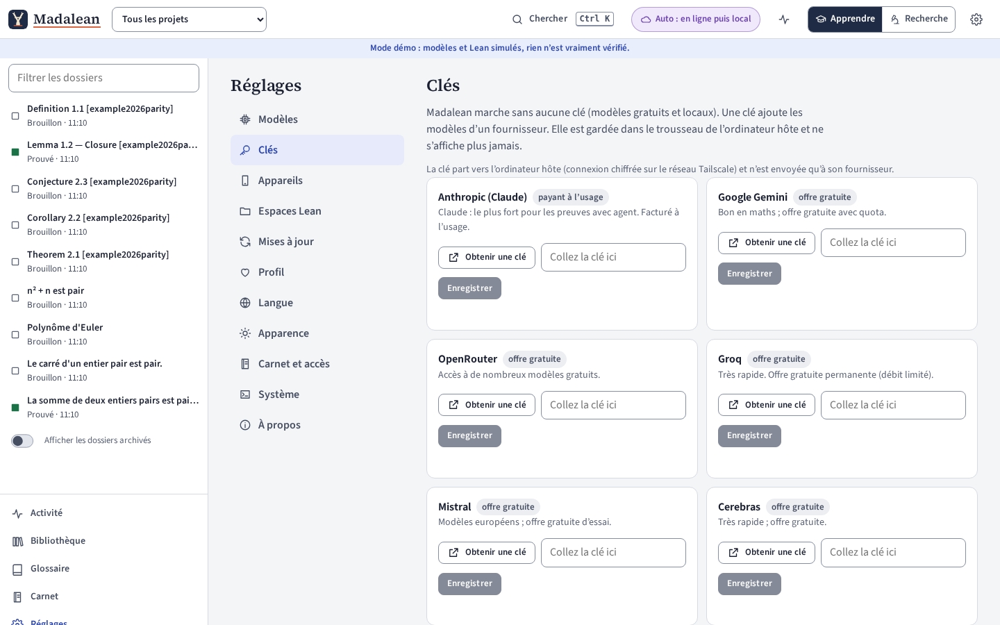
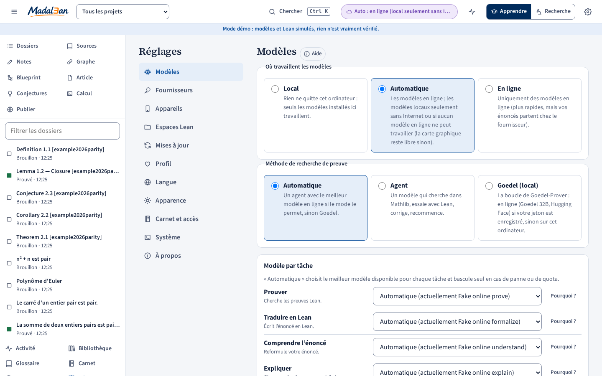

# First configuration

Once Madalean is installed (see [Installing Madalean](install.md)), it **works right away, without any key**: free
online providers that need no account and, if you installed them, the local models are enough to get started. This
page reviews what is worth setting next, in the order you will meet it:

1. the **keys** of online providers, which give access to stronger models;
2. **where the models work**: *Local*, *Automatic* or *Online*;
3. **Learn** or **Research**, and your profile;
4. the **automatic behaviours**, which you can make manual.

Everything is in “Settings” (the gear icon at the top right). A [checklist](#checklist) sums it all up at the end of
the page.

When you open Madalean for the first time (in particular from the graphical installer), a first-run assistant guides
you through these same choices; you can come back to them at any time in “Settings”.
<!-- verify after integration: the in-app first-run assistant (beyond the four-step tour) and its exact screens. -->

## Keys of online providers

An **API key** (or “token”) is a password specific to an online service: it lets Madalean use that service's models
on your behalf. It takes two minutes to create on the provider's site.

### Adding a key

“Settings › Providers” sorts online services by use (Lean proofs, writing, code, Internet search…), with, for each,
what is free and where your data goes. On a provider's card:

1. “Create a key” opens the provider's key page; create an account if needed, then create a key and copy it (it is
   often shown only once);
2. paste it on the card: Madalean **tests it at once** and says how many models it gives, or why it is refused;
3. “Remove the key” deletes it in one click.

### Where keys are kept

- In the **system keyring** (your desktop's password vault: GNOME Keyring, KWallet…), when the `secret-tool` tool is
  available;
- otherwise in the file `~/.config/madalean/keys.json`, readable by you only (permissions `0600`).

A key is **never shown** again, never written to the log, and **never passed to your linked devices**: the server
only says whether a key is set. It is sent only to **its** provider; Madalean refuses to attach it to any other
address.

### Where to start

For a good free start, without a bank card for the first two: **Groq** (fast models), **Google Gemini** (the strongest
free models) and **Tavily** (Internet search). Then add, as needed, a **Hugging Face** token for the best open Lean
prover, and an **Anthropic** key if you accept paying for Claude per use, within caps you set.

### The providers, one by one

Free tiers change often; each card of “Settings › Providers” shows the date they were checked. The information below
is that of this version of Madalean.

**Lean proofs**

| Provider | What it is for | Free? | Where to create the key |
|---|---|---|---|
| Hugging Face (Goedel-Prover-V2-32B) | the best open Lean prover, served online; it opens every proof | no: paid per token with Hugging Face credits (free account: no included credit; PRO account: $2 per month) | <https://huggingface.co/settings/tokens> |
| Mistral (Leanstral) | Mistral's Lean proof agent, put first in the tournament **if** your Mistral key offers it | announced free, but retired by Mistral on 2026-09-30; Madalean detects it by itself if it comes back | same key as Mistral, below |

**Writing, explanations, reasoning**

| Provider | What it is for | Free? | Where to create the key |
|---|---|---|---|
| Google Gemini | the strongest free models for writing (LaTeX, explanations) and reasoning | yes, with per-project limits; the free tier may be used by Google to improve its products: nothing confidential | <https://aistudio.google.com/apikey> |
| Mistral AI | very good in French; Codestral for code | billing must be activated to create a key; an existing key keeps working | <https://console.mistral.ai/api-keys> |
| Anthropic (Claude) | the strongest at Lean and writing; conductor and paid reinforcement (see [below](#claude-conductor-and-paid-reinforcement)) | no: paid per use | <https://console.anthropic.com/settings/keys> |

**Code (Sage, Python) and small tasks**

| Provider | What it is for | Free? | Where to create the key |
|---|---|---|---|
| Groq | very fast: Sage/Python code, small tasks, routing | yes, without a card (30 requests per minute, 1,000 per day per model) | <https://console.groq.com/keys> |
| Cerebras | very fast: code, computation, reasoning | trial: a one-time $5 credit, after adding a card | <https://cloud.cerebras.ai> |
| SambaNova Cloud | free backup model (code, maths) | yes, without a card (20 requests per day per model) | <https://cloud.sambanova.ai/apis> |

**General backup models, and paid models on request**

| Provider | What it is for | Free? | Where to create the key |
|---|---|---|---|
| OpenRouter | “:free” models | yes (50 requests per day; some free models require allowing training on your data) | <https://openrouter.ai/settings/keys> |
| NVIDIA NIM | trial catalogue, as a backup | limited free trial, for testing only; no confidential work | <https://build.nvidia.com> |
| OpenAI | GPT, only when you choose it | no: paid | <https://platform.openai.com/api-keys> |
| DeepSeek | good at maths and code, cheap, only when you choose it (servers in China) | no: paid | <https://platform.deepseek.com/api_keys> |

**Internet search** (for literature research, never in *Local* mode; only the query is sent)

| Provider | Free? | Where to create the key |
|---|---|---|
| Tavily | 1,000 searches per month, no card | <https://app.tavily.com> |
| Exa | $10 of free credits every month | <https://dashboard.exa.ai/api-keys> |
| Brave Search | $5 of free credits per month; a card is required | <https://api-dashboard.search.brave.com> |

**Without a key**, always available: the free models LLM7, OVHcloud, Kilo and Pollinations (what you send them may
be kept: for confidential work, use *Local* mode), Wikipedia for Internet search, arXiv, zbMATH, Crossref, OpenAlex
and Semantic Scholar for bibliography, LeanSearch and Loogle to search Mathlib.

**GitHub** has a card too: its token is used **only** to “Publish” (push a project's site to your GitHub
repository), never for models. See [Publishing a project](publish.md).

A paid model is never used behind your back: only if you chose it for a task, or as reinforcement within your caps
(Claude, Goedel 32B online). What each model receives, and the prices: [Models and keys](models-keys.md).

### Hugging Face token: Goedel-Prover 32B online

With a Hugging Face token, **Goedel-Prover-V2-32B** opens every proof: the same method as the local prover, with a
model four times larger, without using your graphics card.

1. Create an account on Hugging Face and add credits (calls are paid per token).
2. On the Hugging Face card, “Create a key” opens the token page, ready to create a token with the “Make calls to
   Inference Providers” permission; the token starts with `hf_`.
3. Paste it: Madalean checks it without charging anything and says whether Goedel 32B is available.

Setting `hf_goedel` (on by default): “Settings › Models › Advanced settings”, box “Goedel-Prover 32B online (Hugging
Face) opens every proof when the token is saved”. Its spending counts towards the monthly cap described below. One
attempt costs at most ≈ $0.11 (Madalean's conservative estimate).

### Claude: conductor and paid reinforcement

With an Anthropic key, Claude can play two roles, set in “Settings › Models”, “Claude as paid reinforcement” part:

| Role | Setting | Default | What it does |
|---|---|---|---|
| **Conductor** | `conductor`: “Let Claude direct each request” | on | Claude reads each request, picks the best model for each step, fixes what Lean rejects and checks at the end that statement, proof and explanation agree. Without an Anthropic key, the best free model takes this role. Lean remains the only judge of proofs |
| | `conductor_cap_usd`: “Cap per request” | $1 | once reached, Madalean asks whether to continue with Claude, for $0.50 more |
| **Paid reinforcement** | `claude_reinforce`: “Call on Claude when the free models fail” | on | Claude enters a proof's tournament **last**, only if the free models have all failed |
| | `claude_cap_proof_usd`: “Cap per proof” | $1 | beyond it, the call is not made and the proof says so |
| | `claude_cap_month_usd`: “Cap per month” | $20 | for **all** paid calls of the calendar month (Claude and Goedel 32B on Hugging Face) |
| | `claude_model`: “Claude model” | Automatic | the best Claude model for proving, or the one you impose |

Before each call, Madalean estimates its cost at the public price and does not make it if it would exceed a cap;
after the call, the real cost is recorded. The month's total and the latest calls are shown under the caps.
Anthropic's invoice is authoritative. Without an Anthropic key, none of these settings costs anything.

## Where the models work

“Settings › Models”, “Where the models work” part (setting `mode`). The indicator at the top of the screen shows at
all times the current mode and who receives your work.

| Mode | What happens | For whom |
|---|---|---|
| *Local* | nothing leaves the computer: only the models installed on the host work; any connection to the Internet is refused before it is opened | confidential work, computer without Internet; assumes [local models](components.md#local-models) and a good graphics card |
| *Automatic* (default) | online models; local models **only** without Internet, or if no online model can work | the best choice for almost everyone: fast, and the graphics card stays free |
| *Online* | online models only; without a network, the work fails with a clear message | computer without a local model |

A given dossier can have another mode than the general one (“Options for this dossier”, on the home screen). Just
below, “Proof search method” chooses between *Automatic* (an agent with the best online model if the mode allows it,
otherwise Goedel), *Agent* and *Goedel (local)*. Details of what is sent and to whom: [Models and keys](models-keys.md).

## Learn or Research

The button at the top right switches between two ways of working; the choice is kept **on each device** and can be
changed at any time:

- **Learn** (default): guided — hints before the proof, glossary on hover, line-by-line explanations, a tutor who
  has you explain in your own words. For whoever is discovering Lean, student or teacher.
- **Research**: dense, keyboard-oriented, nothing pedagogical in the way. For whoever uses Lean in a research
  project.

**Your profile** (“Settings › Profile”, setting `profile`) tells Madalean whom it is addressing: intended audience,
level, preferred notations. It is read before every translation and every explanation. See also
[First run](first-run.md).

## Automatic and manual behaviours

By default, Madalean chains the steps of a proof by itself, but **never runs code written by a model without your
approval**, and opens nothing to your other devices unless you decide so on the host. Here is each behaviour, its
setting, its default value and where to change it. Settings marked **host** can only be changed from the host
computer (they open the computer to other devices).

A few settings have no switch in the interface: they are changed in the file `~/.config/madalean/settings.json`,
with Madalean stopped (`systemctl --user stop madalean`, edit, then `systemctl --user start madalean`).

**Proof chain** — “Settings › Models › Advanced settings”

| Setting | Default | Label in the application, and effect |
|---|---|---|
| `pause_after_translation` | off | “Pause after the translation (to review it)”: when on, Madalean stops after the translation into Lean and waits for you to approve it; otherwise the chain is fully automatic |
| `statement_check` | on | “Check every statement before proving it (faithfulness, counterexamples)” |
| `mathlib_first` | on | “Look for the theorem in Mathlib first” |
| `tournament_enabled` | on | “Model tournament for proofs”: the best models first, then a race between others; with `tournament_contestants` (3 models per race), `tournament_max_rounds` (3 races), `tournament_max_minutes` (at most 40 min per proof), `tournament_attempts_per_model` (4 attempts of the best model) |
| `lean_warm` | on | “Keep Lean ready in advance during a proof”: attempts are checked in a fraction of a second, at the cost of about 3.4 GB of RAM per Lean workspace in use |
| `lean_warm_idle_minutes` | 10 | “Stop Lean ready in advance after (min without an attempt)” |
| `parallel_stages` | on | *no switch*: once Lean accepts the statement, guided reading, statement check, Mathlib search and proof search move forward together; off (or in *Local* mode), one step after the other |

**Claude** — “Settings › Models”, “Claude as paid reinforcement” part: `conductor`, `conductor_cap_usd`,
`claude_reinforce`, `claude_cap_proof_usd`, `claude_cap_month_usd`, `claude_model`, described
[above](#claude-conductor-and-paid-reinforcement).

**Code and computation** — “Settings › Notebook and access”

| Setting | Default | Label in the application, and effect |
|---|---|---|
| `experiments_auto` | off (host) | “Run experiments without approval”: by default, code written by a model (Sage, Python) **waits for your approval** before running; turning it on is not advised |
| `experiments_remote` | off (host) | “Allow experiments from linked devices” (the code still runs on the host, in the sandbox) |
| `agent_exec` | off (host) | “Let the agent run code”: the agent can then start computations in the project folder |
| `remote_jupyter` | off (host) | “Open the notebook to linked devices” |
| `lan_listener` | off (host) | “Access from the local network (without Tailscale)”: for a home network without Tailscale; devices must still be linked |

**Computer resources** — no switch (`settings.json` file)

| Setting | Default | Effect |
|---|---|---|
| `local_idle_unload_minutes` | 10 | the local model stops after this time without work, to give the graphics memory back (0 = never) |
| `calcul_idle_minutes` | 30 | the kernel of a “Calcul” notebook stops after this time without activity (0 = never) |
| `browser_session_idle_minutes` | 120 (host) | a session opened in a browser from another device closes after this idle time |

**Network and updates**

| Setting | Default | Where, and effect |
|---|---|---|
| `check_updates` | on | “Settings › Updates” › “Check for updates every week” (never in *Local* mode) |
| `updates_auto` | on (host) | “Settings › Updates” › “Install automatically when nothing is running”: unticked, you are told before each installation. See [Updates](updates.md) |
| `web_search` | on | “Settings › Providers” › “Internet search for literature research” (never in *Local* mode; only the query is sent) |
| `offline` | — | old setting of Lean AI Station 1.x, replaced by *Local* mode; it is only used when importing version 1 settings |

## Choices made at installation

The installer (graphical or terminal) writes your choices to `~/.config/madalean/setup.json`; Madalean applies them
at first start. Two of them become settings:

| Setting | Values | Default | Effect |
|---|---|---|---|
| `sage_source` | `auto`, `own`, `system` | `auto` | which SageMath to use: `auto` = Madalean's copy when installed, else the system's; `system` = the system's only; `own` = Madalean's copy only (see [SageMath](components.md#sagemath)) |
| `tex_engine` | `auto`, `tectonic`, `system` | `auto` | which LaTeX to use: tectonic first, the system's TeX Live as a fallback (see [LaTeX](components.md#latex)) |

The local models chosen at installation are simply the files present in `~/models`.

<!-- verify after integration: where sage_source and tex_engine appear in the app (first-run wizard, Settings). -->

## Checklist

| To do | Where | Essential? |
|---|---|---|
| Open Madalean and check that everything is fine | “Settings › System”, “Health” part | yes |
| Install bubblewrap if the sandbox is reported inactive | terminal, see [bubblewrap](components.md#bubblewrap-the-sandbox) | strongly recommended |
| Add one or two free keys (Groq, Gemini) | “Settings › Providers” | recommended |
| Add an Internet search key (Tavily) | “Settings › Providers” | for literature research |
| Hugging Face token, Anthropic key, and their caps | “Settings › Providers”, then “Settings › Models” | optional, paid |
| Choose where the models work | “Settings › Models” | the default *Automatic* almost always suits |
| Choose Learn or Research, fill in the profile | button at the top right; “Settings › Profile” | recommended |
| Decide on the automatic behaviours | “Settings › Models › Advanced settings”, “Settings › Notebook and access” | the defaults are cautious |
| Link a phone or another PC | “Settings › Devices”, see [Link a device](pairing.md) | if you need it |
| Make a first try | the home screen, see [First run](first-run.md) | — |
