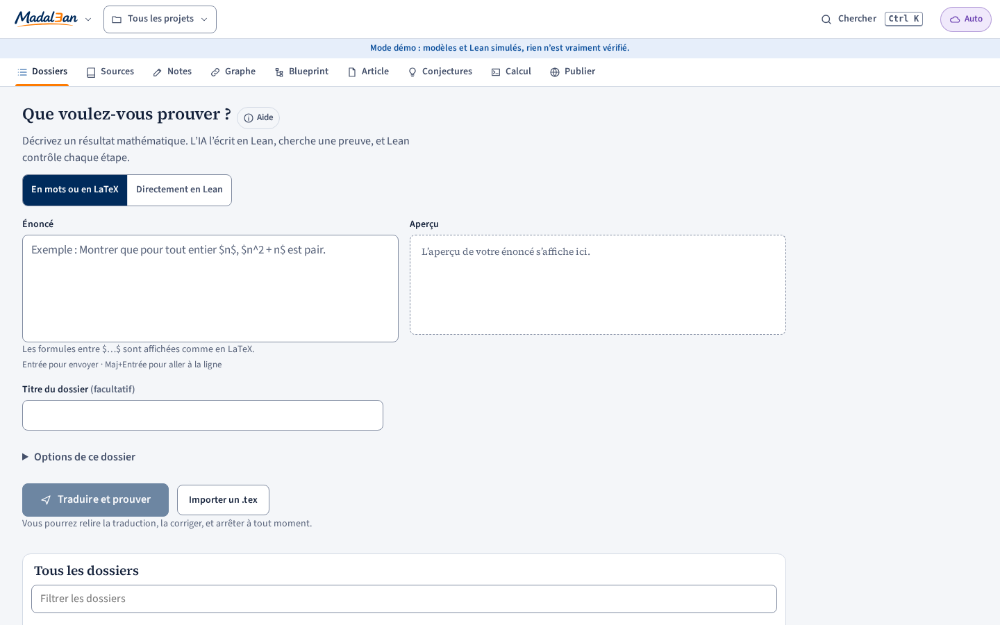

# Madalean manual

Madalean is a proving assistant for **Lean 4** and **Mathlib**. You write a statement in plain language (LaTeX
formulas between dollar signs are accepted); AI models translate it into Lean, search for a proof and explain it;
**Lean decides**. Nothing is ever presented as proved unless Lean accepted it under the strict verdict: no error, no
`sorry`, no axiom other than Lean's three standard axioms (`propext`, `Classical.choice`, `Quot.sound`).

A single computer, the **host computer**, does all the work: Lean, local models, storage. Every screen (this
computer, another PC, a tablet, a phone) shows the **same web interface** and stays synchronised. Devices reach the
host only through your private Tailscale network.

## What Madalean does not do

- It does not guarantee that the Lean translation says what you meant. Lean checks the proof **of the Lean
  statement**, not of your sentence. Always read the translation: see [Reading a Lean statement](reading-lean.md).
- It does not find every proof. “No proof found” does not mean the statement is false.
- It sends nothing over the Internet in **Local** mode. In the other modes, what is sent and to whom is described in
  [Models and keys](models-keys.md).

## Map of the manual

- **Getting started**: [Installing Madalean](install.md) · [What Madalean installs](components.md) ·
  [First configuration](first-config.md) · [First run](first-run.md) ·
  [Link a phone, a tablet, a PC](pairing.md) · [Tailscale](tailscale.md)
- **Working**: [From statement to proof](workflow.md) · [Reading a Lean statement](reading-lean.md) ·
  [Follow-up requests and versions](follow-ups.md) · [Projects and parallel dossiers](projects.md) ·
  [Proof plans and lemmas](proof-plans.md)
- **Research**: [Conjecture workshop](conjectures.md) · [Sources and grounded questions](sources.md) ·
  [Bibliography, article, blueprint](articles.md) · [Notes](notes.md) · [Jupyter and Sage](jupyter.md) ·
  [Publishing a project](publish.md)
- **Settings and security**: [Models and keys](models-keys.md) · [Updates](updates.md) ·
  [Security](security.md)
- **Reference**: [Troubleshooting](troubleshooting.md) · [Lean glossary](glossary.md) ·
  [First tactics](tactics.md) · [Keyboard shortcuts](shortcuts.md)

## Conventions of this manual

- Names in quotation marks (“Send”, “Settings › Devices”) are those of the interface's buttons and menus.
- `lean` code blocks are Lean 4 with Mathlib. They follow the Mathlib version of the “Prover” workspace (Lean 4.9)
  unless stated otherwise; a few notations have changed since, and these are pointed out.
- Pages marked *learner* are for people discovering Lean; *researcher* for people using it for a research project.
  Most concern everyone.
