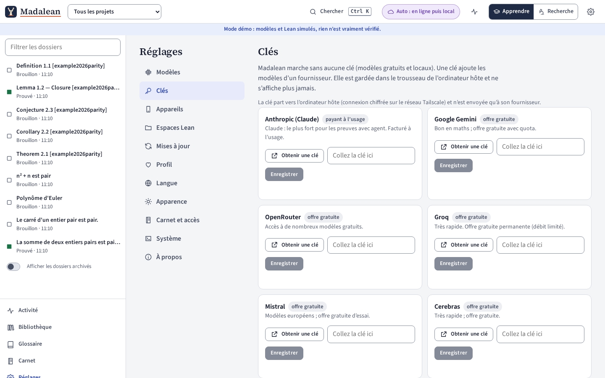

# Models and keys

Madalean works **without any key**: local models installed on the host and free online providers that need no
account. A key adds a provider's models, often stronger ones. The list of providers, with what is free and where to
create each key, is in [First configuration](first-config.md#keys-of-online-providers); the local models are
described in [What Madalean installs](components.md#local-models).

## The three modes

| Mode | Who works | Network |
|---|---|---|
| *Local* | only the host computer's models (Goedel-Prover, Goedel-Formalizer, Qwen3, and Ollama if it is running) | nothing leaves the host; any non-local connection is refused before it is opened |
| *Automatic* (default) | the online models (with a Hugging Face token, Goedel-Prover 32B opens every proof) | the local models **only** without Internet, or when no online model can work (all down, paused or refused); otherwise the local model is not loaded and the graphics card stays free |
| *Online* | online models only | without network, the work fails with a clear message |

Madalean tells “no Internet” (a quick, cached probe) from “a provider is down” (the Internet answers but not that
provider): without Internet it moves at once to the local models; a provider that is down is only skipped for a
minute. In *Automatic* mode, a proof that the online models searched without finding it is **not** re-run on the
local model (the online Goedel 32B is stronger than the local 8B).

For a given dossier, “Options for this dossier” (on the home screen) lets you choose another mode than the general
one. The status button at the top right of the screen
(its panel “Who receives what”) tells at every moment which model receives your work, with the tokens and cost spent. Every text produced by a model shows
its name.

## What is sent, and to whom

| Stage | What the model receives |
|---|---|
| Understanding | your statement in plain language |
| Translation into Lean | your statement and its reformulation |
| Proof | the Lean statement, Lean's error messages, Mathlib lemmas retrieved for the statement |
| Explanation, written proof | the statement and the Lean proof |
| Questions about sources | your question and the selected passages of your sources |
| Compute (“Ask” cell) | your request and the names already defined in the notebook (not the full outputs) |

What is **never** sent to a model: your API keys, your device tokens, your other dossiers, your files. A key is sent
only to **its** provider: Madalean refuses to attach a key to an address that is not that provider's.

The free providers without an account shipped with Madalean (LLM7.io, OVHcloud AI Endpoints, Kilo Code,
Pollinations) apply their own terms; assume that what you send them may be retained. For confidential work, use
*Local* mode.

## Adding a key

“Settings › Providers” lists the online services by use, with what is free and where your data goes. On a
provider's card, “Create a key” opens its key page; paste the key, Madalean **tests it at once** (“It works: N models available”, or the reason
for the refusal). The key is kept in the host computer's keyring (otherwise in a file readable only by you) and is
never shown again. “Remove the key” deletes it in one click.

### Anthropic key (Claude)

1. On the Anthropic card, “Create a key” opens the key page of Anthropic's console; create an account if needed.
2. Claude is pay-as-you-go: follow Anthropic's instructions to add a payment method or credits.
3. Create a key and copy it (it starts with `sk-ant-`). It is usually shown only once.
4. Paste it on the Anthropic card.

Advice: if Anthropic's console allows it, set a spend limit there too; Madalean has its own caps anyway (see
below).

### Google Gemini key

1. On the Google Gemini card, “Create a key” opens the key page of Google AI Studio (with a Google account).
2. Create a key and copy it.
3. Paste it on the Google Gemini card.

Gemini's free tier has quotas; when they are reached, Madalean moves on to the next model. The data-use terms differ
between offers and may change: read Google's before sending unpublished work with a free key.

### Hugging Face token (Goedel-Prover 32B online)

With a Hugging Face token, **Goedel-Prover-V2-32B** (served online by a Hugging Face partner provider) opens every
proof: the same loop as the local Goedel — same prompts, ≤ 2 corrections per line of attack, same sampling —,
with the 32B model instead of the 8B, without using the graphics card. If it fails, the free models take over (the
tournament). Goedel-Formalizer is used the same way as soon as a provider serves it online.

1. Create an account on the Hugging Face website (`huggingface.co`). Calls are paid with Hugging Face credits (the terms of the offer
   are on Hugging Face's site).
2. On the Hugging Face card, “Create a key” opens Hugging Face's token page, ready to create a token with the “Make
   calls to Inference Providers” permission; create the token (it starts with `hf_`).
3. Paste it: Madalean checks the token (nothing billed) and says whether Goedel 32B is available online.

The token is only sent to `router.huggingface.co` (inference) and `huggingface.co` (the token check). The list of
Goedel models served online is read from Hugging Face's public API, **without** the token. It can be turned off in
“Settings › Models › Advanced settings” (“Goedel-Prover 32B online (Hugging Face) opens every proof when the token is
saved”).

## What it costs

Paid providers bill by the number of *tokens* (≈ ¾ of a word) sent and received. Anthropic's public prices that this
version of Madalean uses for its estimates, per million tokens (input / output); the prices in force are those on
Anthropic's site:

| Model | Input | Output |
|---|---|---|
| Claude Opus 5.5 | $4 | $20 |
| Claude Sonnet 5.5 | $2 | $10 |
| Claude Haiku 5.5 | $0.10 | $0.50 |

The cost of a proof depends on the statement and the number of attempts; it is bounded by the per-proof cap (see
below), and each paid call is shown with its cost under the caps. The limits (agent steps and duration, attempts,
duration of a proof) are set in “Settings › Models › Advanced settings”. A paid model is used only if you chose it
for a task, or as reinforcement (Claude, below).

**Goedel-Prover 32B online (Hugging Face).** The provider publishes no per-token price for this model: Madalean
uses a **conservative estimate** of $1.00 (input) / $3.20 (output) per million tokens, replaced by the published
price as soon as Hugging Face gives one. One Goedel attempt (up to 32,768 output tokens) costs at most ≈ $0.11; the 4
attempts of a proof's first round at most ≈ $0.45. The real cost is shown in the billing area of your Hugging Face
account.

## Claude as paid reinforcement, with caps

With an Anthropic key, Claude can join a proof's tournament **last**, only when all the free models failed
(“Settings › Models”, “Claude as paid reinforcement” part, “Call on Claude when the free models fail” box, ticked
by default). Two caps, editable there:

- “Cap per proof” ($1.00 by default);
- “Cap per month”, per calendar month ($20 by default), for every paid call — Claude, including a role where you chose it, and
  Goedel online on Hugging Face (same caps, same ledger).

Before each call, Madalean estimates the cost at list prices (request size and allowed answer length) and shortens
the allowed answer if needed; if even a short answer would pass a cap, the call **is not made** and the proof says so.
After the call, the real cost is computed from the usage Anthropic returns (input, output, cache read and cache write
tokens) and written to a small private ledger on the host. The month's total (“Spent in …”) and the latest calls are
shown under the caps. This total is computed at list prices: Anthropic's invoice is what counts.

## Choosing a model per role

“Settings › Models”, “Model per task” part, shows, for each task (understand the statement, translate to Lean,
prove, explain, assistant…), the ranking of the available models and the reason for the ranking (“Why?”). “Automatic” lets the router choose; you can impose a model. A
model in error (quota, refused key, overload) is paused and the next one takes over.
