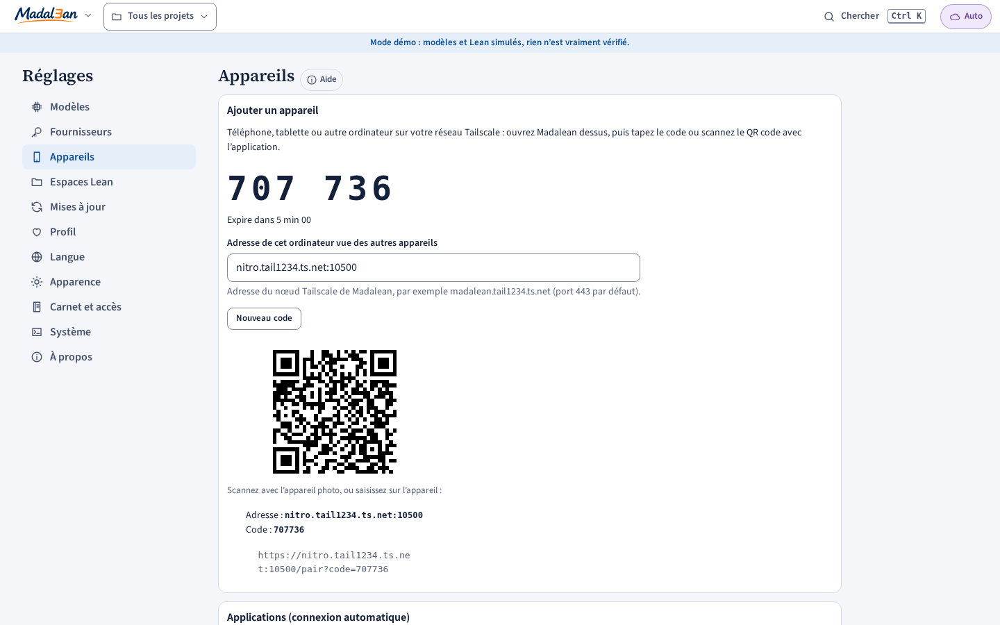
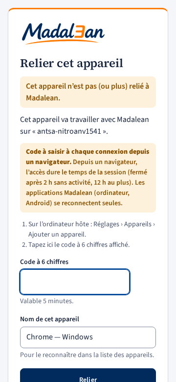

# Link a phone, a tablet or another PC

A linked device shows the same interface as the host computer and stays synchronised with it: what you start on the
phone appears on the PC, and vice versa. All computation stays on the host.

Three things are needed:

1. the host computer switched on, Madalean running;
2. the host and the device on **your Tailscale network** (see [Tailscale](tailscale.md));
3. a **6-digit code** shown by the host.

On the host computer itself, no code is needed.

**App or browser?**

- The **Madalean apps** (Android, Linux desktop) are linked **once**: afterwards they reconnect by themselves, even
  after the host restarts.
- From a **browser** (iPhone, iPad, another PC without the app), a **code is needed at every connection**: access
  lasts for the session, closes after **2 h without activity** (adjustable on the host), after **12 h** at most, and
  when the host restarts.

## Step 1 — Put the host on your Tailscale network (once)

Madalean brings **its own Tailscale node**: on your tailnet, the host appears as a separate machine named
`madalean`, at the address `https://madalean.tailXXXX.ts.net` (normal HTTPS port, no port number to type). Nothing
needs installing on the host for this: neither the system's Tailscale nor `tailscale serve`.

The first time, this node must be **approved** in your Tailscale account (Madalean never approves anything itself):
open the Tailscale login link it provides, sign in and accept the `madalean` machine. For now, this link is read on
the host, in a terminal:

```bash
curl -s http://127.0.0.1:11500/api/net
```

(`auth_url` line). Once the node is approved, the same command shows `"state": "running"` and the host's full name
(`dns_name`). The tailnet must have HTTPS certificates enabled: see [Tailscale › Enable HTTPS](tailscale.md#enable-https).

If you prefer to go through the Tailscale already installed on the host, see
[Tailscale › Alternative](tailscale.md#alternative-the-systems-tailscale).

## Step 2 — Show a code on the host

On the host computer: “Settings › Devices”, “Add a device” part, “Show a code” button. A 6-digit code appears, valid
for **5 minutes**, usable **once**, with a QR code.



The field “Address of this computer as seen from other devices” fills in by itself when Madalean's Tailscale node is
running (for example `madalean.tail1234.ts.net`). It is used to build the QR code. The QR code also carries fallback
addresses, which the Android app tries if the name does not answer: the host's Tailscale IP address and, if access
from the local network is turned on, its local network address (port 11502 by default, see
[Tailscale › Without Tailscale](tailscale.md#without-tailscale)).

## Step 3 — On the device

### Android phone or tablet

1. Install the **Tailscale** app (Play Store) and sign in with **the same account** as on the host.
2. Install the **Madalean** app from the [install page](site:install) (APK file; Android asks you to allow
   installation from your browser, once).
3. Open Madalean, tap “Scan the QR code” and point at the QR code shown on the host: the address and the code fill
   in by themselves. The app asks for camera access, only to read this QR code. Otherwise, “Or enter the address and
   code” lets you type them by hand.
4. Give the device a name (“Marie's Pixel”) and tap “Pair and open”.



### iPhone, iPad, or any device with a browser

There is no iOS app. Install Tailscale (App Store), then open the host's address in the browser, for example
`https://madalean.tail1234.ts.net`. The “Link this device” page asks for the code and a device name, then “Link”.
Scanning the host's QR code with the camera opens this page directly, with the code filled in.
**A code is needed at every connection from a browser**: at the next visit (or after 2 h without activity), show a
new code on the host.

### Another Linux computer

Install Tailscale, then either a browser (as above) or the **Madalean** desktop app (AppImage,
[install page](site:install)), which keeps the token in the system keyring and reconnects by itself.

## What happens when linking

- **App**: the device sends the code; the host gives it a secret **token** (256 bits), kept in the system keyring,
  that identifies it from then on. The host keeps only a fingerprint of this token, never the token itself.
- **Browser**: the host opens a **temporary session** (a session cookie, erased when the browser closes, that no page
  can read); it is never turned into a permanent token and the host keeps it in memory only.

Five wrong codes in a row lock linking for 10 minutes. Details: [Security](security.md).

## Unlinking a device

- From the host: “Settings › Devices”, the “Unlink” button next to the device. The page shows two lists:
  “Applications (automatic connection)” and “Browsers (temporary session)”. Access is cut **immediately**:
  a page that is already open loses its live connection at once, stops any answer still being written for it, and
  goes back to the linking screen. The same happens when a browser session ends (inactivity, 12 h limit) and when
  the device unlinks itself.
- From the device itself: “Settings › Devices › Unlink this device”. In the Android app, “Forget” also removes a
  saved server from the connection screen.

Unlinking a lost phone is the first thing to do; your Tailscale account also lets you remove the device from the
private network.

## If it does not work

| Message | What to do |
|---|---|
| “Wrong code” | Type again the 6 digits shown on the host. |
| “This code has expired” | “New code” on the host (valid for 5 minutes). |
| “Too many tries: linking is locked for N min” | Wait, then ask for a new code. |
| The address does not answer | Is Tailscale connected on both devices? See [Troubleshooting](troubleshooting.md#the-device-cannot-reach-the-host). |
