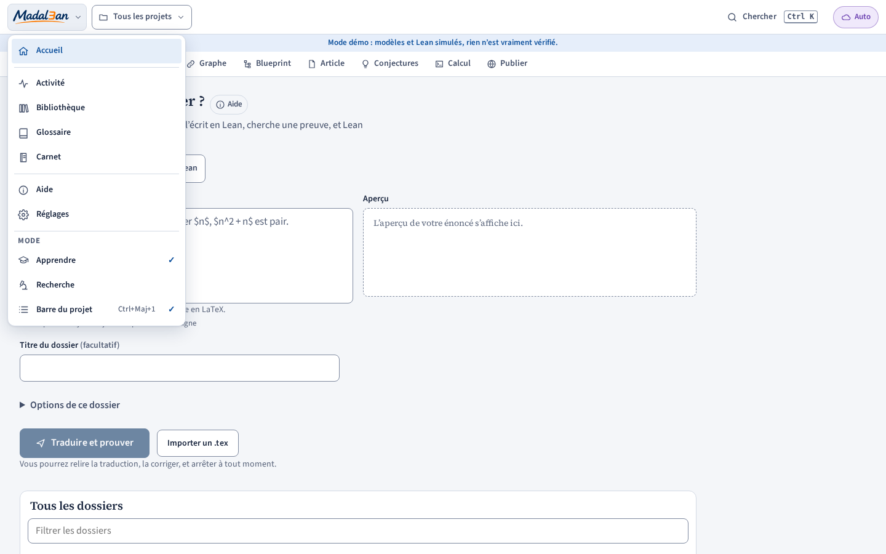
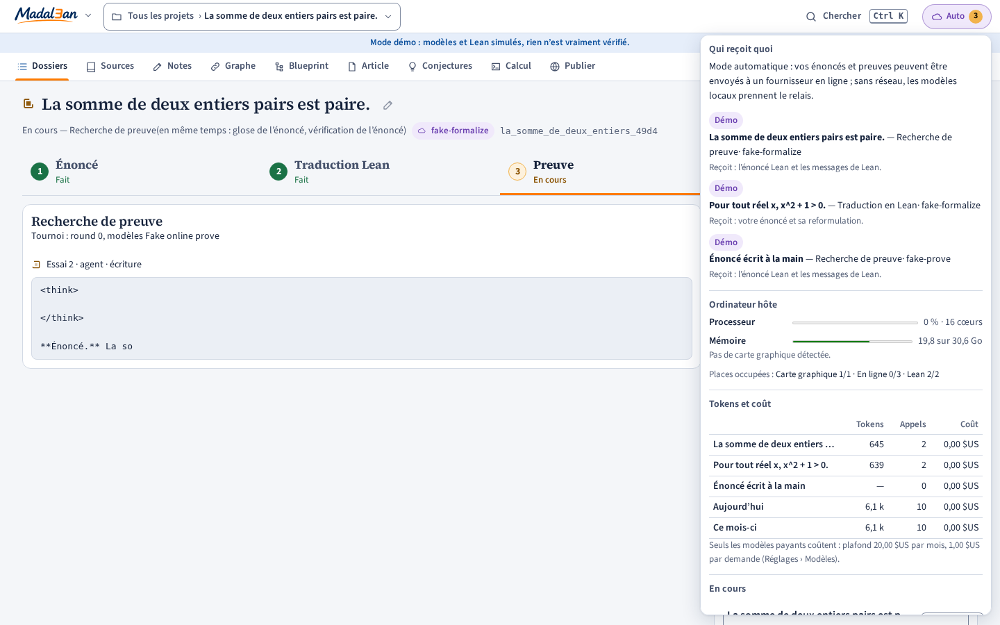

# Projects and parallel dossiers

## Finding your way

Everything is in the same place on a computer, a tablet or a phone:

- **The Madal∃an logo**, top left, opens the menu: “Home” first, then Activity, Library, Glossary, Notebook, Help,
  Settings, the *Learn* / *Research* choice and the project bar. A second click on the logo, menu open, goes home.
- **The project name** (and, in a dossier, the dossier's) next to the logo is the one place to change project or
  dossier: projects on the left (“New project…”, “Project overview”), the chosen project's dossiers on the right,
  with their state. Names are written in full.
- **The project bar**, under the top bar: Dossiers · Sources · Notes · Graph · Blueprint · Article · Conjectures ·
  Calcul · Publish. `Ctrl+Shift+1` hides or shows it.
- **The status button**, top right (cloud: online; chip: local): the mode, the model receiving your work, the host's
  resources (processor, memory, graphics card), tokens and cost (this request, today, this month), running jobs.
  These measurements are only taken while the panel is open.

A menu or a panel closes with a click elsewhere or `Esc`. **Everything saves itself**: a dossier's title and
statement, notes, the article, Calcul cells, experiment code, the plan, the project description, settings. A small
“Saved” confirms it; “Not saved — retrying” signals a network problem (Madalean retries, your text stays on screen).

## Projects

A **project** groups dossiers: a course chapter, a paper in preparation, a set of exercises. The project name at the
top left (“All projects”) chooses one; the “Dossiers” page then shows its dossiers. A project has its Lean workspace,
its bibliography, its sources, its notes, its article outline; its title and description are edited on its page
(“Project overview”).

Deleting a project moves it to the trash: “Undo” restores it. Its dossiers are not deleted.

## Several dossiers at once

You can start as many dossiers as you like; they progress in parallel, limited by the host's resources:

| Resource | Slots | Used by |
|---|---|---|
| graphics card | 1 | one local model at a time (Madalean switches models according to the stage) |
| online | 3 | calls to online models |
| Lean | 2 | compilations |

A job only waits for the resource of its current stage; your jobs go before automatic retries. The “Activity” screen
shows what is running, what is waiting and why (“waiting: graphics card”).

A dossier has only one active job at a time; a new request on a busy dossier is refused with a clear message. Any job
stops on request.

## On every device

All linked devices see the same projects, the same dossiers and the same jobs live. Start a proof from the phone,
follow it on the PC. After a network cut, the device resynchronises by itself.

## Lean workspaces

Each project uses a Lean **workspace** (“Settings › Lean workspaces”):

- *Prover*: Lean 4.9 and the Mathlib the Goedel models were trained on. Pinned: it is never updated, so that the
  local models remain effective.
- *Current Lean*: latest Mathlib, updated automatically (see [Updates](updates.md)).

A library result can be reused only in the workspace where it was proved.
