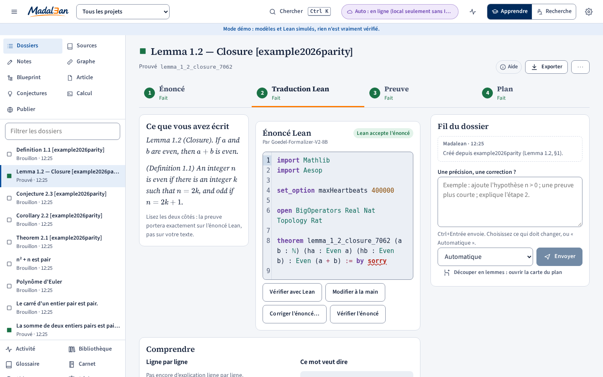

# From statement to proof

Each problem lives in a **dossier**. At the top of the screen four steps say where you are:
**Understand › Translate › Prove › Verify**, each “not started”, “in progress”, “waits for you”, “done” or “failed”.
Just below, a single **“Right now”** line says what Madalean is doing, the attempt number, the model, for how long and
what runs beside; “Stop” is always there. When it is your turn it says so and takes you there; after a failure it leads
to what was tried, the last cause and what you can do.

At the centre, the **thread** tells everything in order: your requests, then each phase, its attempts (folded), the
models' live output, the sub-dossiers where they were created. Filters show only your requests, the results, the checks
or the attempts. The field at the bottom says what your request is **about**.

Beside it, the **pane** holds the references: Statement, Lean, Proof, Sub-lemmas (tree, plan and graph), Literature,
Computations, Versions. “Separate” puts a part in its own window or in a column, “Put back” returns it. The pane can be
resized and hidden; on a phone, the “References” button opens it over the thread.

### Your two approvals

Before any proof, Madalean shows what it **understood** (restated text, objects, hypotheses, claim, what is known with
quotes), then the **Lean statement** with its plain-language reading. For each: “Approve”, “Correct” or “Reject”.
“Lean understands the code” means neither “faithful” nor “proved”. An open problem is announced as such; the known
results around it become sub-dossiers that a single card can approve. The status “according to a model, to be checked”
has no reference.

### “Misunderstood”

On the meaning, the statement, the proof or a message, “Misunderstood” reports a wrong reading: a reason, a few words,
and the step is redone with your remark.

## 1. Writing the statement

Write in your own words, in French or English. LaTeX formulas between dollar signs are read: `$a^2+b^2 \ge 2ab$`.
A preview shows how the statement will be understood. You can also:

- **import a `.tex` file**: Madalean extracts its theorem-like environments and you choose which one to prove;
- **paste a Lean statement directly**: the translation stage is then skipped.

A precise statement translates better: name the sets ($n \in \mathbb{N}$, $x \in \mathbb{R}$), the hypotheses and
the conclusion.

## 2. The translation into Lean

A first model restates your request as a precise mathematical statement (“incomplete basis theorem” becomes “every
linearly independent family of a finite-dimensional vector space extends to a basis”). A second translates it into
Lean; **Lean checks that the statement is well formed** before going further. The note “Lean understands the code”
only means that the statement makes sense to Lean, not that it is true, nor that it says what you meant.

**Read this translation.** It is the one place where an error goes unnoticed: Lean will prove exactly the Lean
statement. The usual pitfalls (integer division, truncated subtraction on $\mathbb{N}$, division by zero) are in
[Reading a Lean statement](reading-lean.md). In *Learn* mode, the “Understand” panel explains the statement line by
line, and each Lean word on hover.

To correct it: “Edit by hand” (you edit the code, Lean checks it again), or “Fix the statement…” (you describe the
correction, the model rewrites).

## 3. The proof

Madalean searches for a proof with the method chosen in “Settings › Models”:

| Method | How it works |
|---|---|
| *goedel* | the local Goedel-Prover model writes a proof; if Lean rejects it, it reads the error and corrects, several times |
| *agent* | a model that can use tools compiles its own attempts with Lean and looks up lemmas in Mathlib |
| *auto* (default) | agent with the best allowed online model, otherwise goedel; goedel also as a fallback when the agent fails |

Whatever the method, the final proof is **checked again by the server** with the strict verdict. The badge “Proof
checked by Lean” gives the Lean version, the Mathlib revision, the duration, the number of attempts, the model that
wrote it and the axioms used.

During the search the models' text arrives live at the end of the thread, with each compiled attempt. “Stop” cuts everything, at any
time (model request and Lean compilation).

In *Learn* mode the proof is not shown at once: a hint ladder (nudge, strategy, key lemma, next step, full proof)
lets you search first. The last level is always the proof checked by Lean, never a model's text.

## 4. The explanation

Once the proof is accepted, a model explains it in plain language and writes a **natural-language proof** (the one
that goes into the PDF). These texts are editable drafts: you can correct them by hand, and a manual edit is never
overwritten without your consent.

## 5. Export

“Export” offers:

| Format | Content |
|---|---|
| PDF | title, natural-language statement, Lean statement and its gloss, written proof, Lean proof, verification stamp (Lean version, Mathlib revision, date, axioms, model), tactic-by-tactic explanation in an appendix |
| LaTeX (`.tex`) | the same document, to compile with XeLaTeX (for example on Overleaf) |
| Lean (`.lean`) | the file that compiles |
| Markdown (`.md`) | text and `$…$` formulas |
| Everything (`.zip`) | all of the above, with `refs.bib` if the dossier cites sources |

An unproved dossier is exported marked “Not proved” and without a stamp. If no TeX engine is installed on the host,
Madalean opens an HTML version: use the browser's “Print › Save as PDF”.

## What next

- Refine: [Follow-up requests and versions](follow-ups.md).
- Several related results: [Projects and parallel dossiers](projects.md).
- A result too big for a single proof: [Proof plans and lemmas](proof-plans.md).
- Each proved result goes into the **Library** and serves as a lemma for later proofs in the same Lean workspace.
