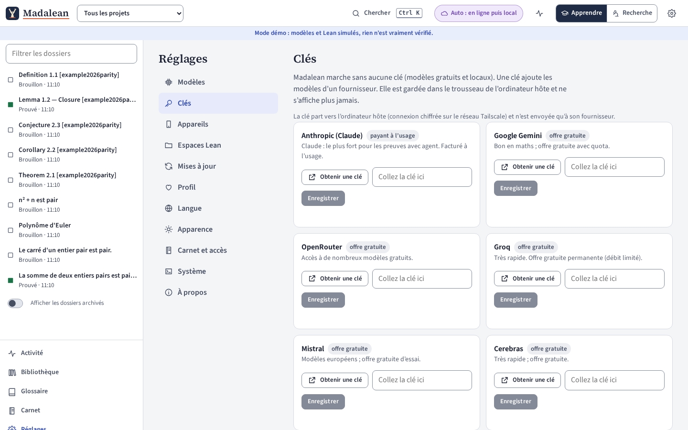
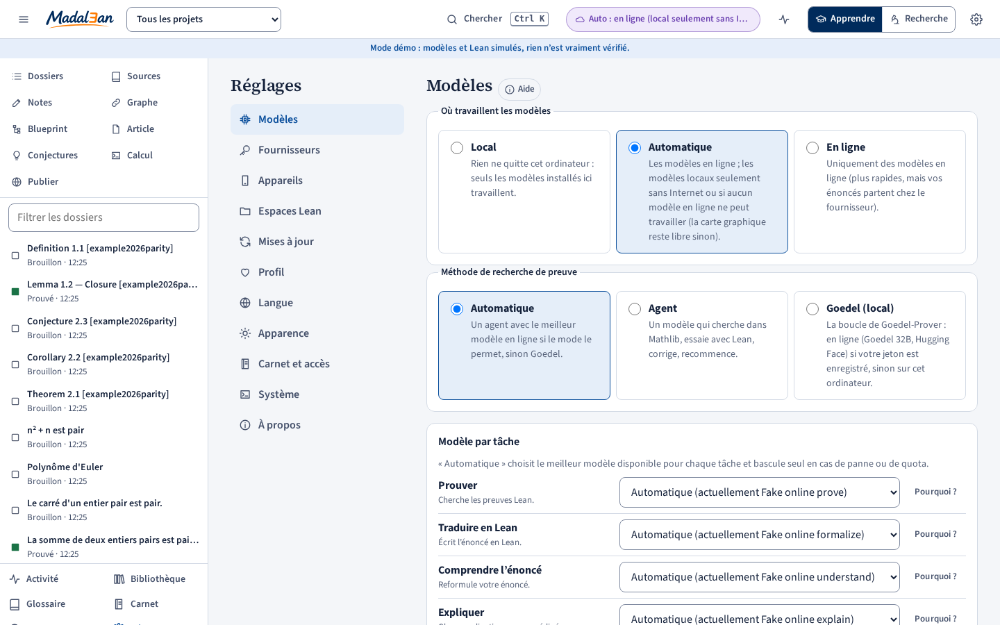

# Première configuration

Une fois Madalean installé (voir [Installer Madalean](install.md)), il **fonctionne tout de suite, sans aucune
clé** : des fournisseurs en ligne gratuits sans compte et, si vous les avez installés, les modèles locaux suffisent
pour commencer. Cette page passe en revue ce qu'il est utile de régler ensuite, dans l'ordre où vous le
rencontrerez :

1. les **clés** des fournisseurs en ligne, qui donnent accès à des modèles plus forts ;
2. **où travaillent les modèles** : *Local*, *Automatique* ou *En ligne* ;
3. **Apprendre** ou **Recherche**, et votre profil ;
4. les **comportements automatiques**, que vous pouvez rendre manuels.

Tout se trouve dans « Réglages » (l'icône d'engrenage en haut à droite). Une [liste de vérification](#liste-de-verification)
récapitule le tout à la fin de la page.

Quand vous ouvrez Madalean pour la première fois (en particulier depuis l'installateur graphique), un assistant de
premier démarrage vous guide à travers ces mêmes choix ; vous pouvez y revenir à tout moment dans « Réglages ».
<!-- verify after integration: the in-app first-run assistant (beyond the four-step tour) and its exact screens. -->

## Clés des fournisseurs en ligne

Une **clé d'API** (ou « jeton ») est un mot de passe propre à un service en ligne : elle permet à Madalean d'utiliser
les modèles de ce service en votre nom. Elle se crée en deux minutes sur le site du fournisseur.

### Ajouter une clé

« Réglages › Fournisseurs » range les services en ligne par usage (preuves Lean, rédaction, code, recherche
Internet…), avec pour chacun ce qui est gratuit et où partent vos données. Sur la carte d'un fournisseur :

1. « Créer une clé » ouvre la page de clés du fournisseur ; créez un compte si besoin, puis créez une clé et
   copiez-la (elle n'est souvent montrée qu'une seule fois) ;
2. collez-la sur la carte : Madalean la **teste aussitôt** et dit combien de modèles elle donne, ou pourquoi elle est
   refusée ;
3. « Retirer la clé » la supprime en un clic.

### Où les clés sont gardées

- Dans le **trousseau du système** (le coffre à mots de passe de votre bureau : GNOME Keyring, KWallet…), quand
  l'outil `secret-tool` est disponible ;
- sinon dans le fichier `~/.config/madalean/keys.json`, lisible par vous seul (droits `0600`).

Une clé n'est **jamais affichée** de nouveau, jamais écrite dans le journal, et **jamais transmise à vos appareils
reliés** : le serveur dit seulement si une clé est enregistrée. Elle n'est envoyée qu'à **son** fournisseur ;
Madalean refuse de la joindre à une autre adresse.

### Par où commencer

Pour un bon départ gratuit, sans carte bancaire pour les deux premiers : **Groq** (modèles rapides), **Google
Gemini** (les plus forts des modèles gratuits) et **Tavily** (recherche Internet). Ajoutez ensuite, selon vos
besoins, un jeton **Hugging Face** pour le meilleur prouveur Lean ouvert, et une clé **Anthropic** si vous acceptez
de payer Claude à l'usage, dans des plafonds que vous fixez.

### Les fournisseurs, un par un

Les offres gratuites changent souvent ; chaque carte de « Réglages › Fournisseurs » indique la date à laquelle elles
ont été vérifiées. Les informations ci-dessous sont celles de cette version de Madalean.

**Preuves Lean**

| Fournisseur | À quoi il sert | Gratuit ? | Où créer la clé |
|---|---|---|---|
| Hugging Face (Goedel-Prover-V2-32B) | le meilleur prouveur Lean ouvert, servi en ligne ; il ouvre chaque preuve | non : payé au jeton avec des crédits Hugging Face (compte gratuit : pas de crédit inclus ; compte PRO : 2 $ par mois) | <https://huggingface.co/settings/tokens> |
| Mistral (Leanstral) | agent de preuve Lean de Mistral, mis en tête du tournoi **si** votre clé Mistral le propose | annoncé gratuit, mais retiré par Mistral le 30/09/2026 ; Madalean le détecte tout seul s'il revient | même clé que Mistral, ci-dessous |

**Rédaction, explications, raisonnement**

| Fournisseur | À quoi il sert | Gratuit ? | Où créer la clé |
|---|---|---|---|
| Google Gemini | les plus forts des modèles gratuits pour rédiger (LaTeX, explications) et raisonner | oui, avec des limites par projet ; l'offre gratuite peut servir à Google pour améliorer ses produits : rien de confidentiel | <https://aistudio.google.com/apikey> |
| Mistral AI | très bon en français ; Codestral pour le code | la facturation doit être activée pour créer une clé ; une clé existante reste valable | <https://console.mistral.ai/api-keys> |
| Anthropic (Claude) | le plus fort en Lean et en rédaction ; chef d'orchestre et renfort payant (voir [plus bas](#claude-chef-dorchestre-et-renfort-payant)) | non : payant à l'usage | <https://console.anthropic.com/settings/keys> |

**Code (Sage, Python) et petites tâches**

| Fournisseur | À quoi il sert | Gratuit ? | Où créer la clé |
|---|---|---|---|
| Groq | très rapide : code Sage/Python, petites tâches, routage | oui, sans carte (30 requêtes par minute, 1 000 par jour et par modèle) | <https://console.groq.com/keys> |
| Cerebras | très rapide : code, calcul, raisonnement | essai : 5 $ offerts une fois, après ajout d'une carte | <https://cloud.cerebras.ai> |
| SambaNova Cloud | modèle de secours gratuit (code, maths) | oui, sans carte (20 requêtes par jour et par modèle) | <https://cloud.sambanova.ai/apis> |

**Modèles généraux de secours, et modèles payants au choix**

| Fournisseur | À quoi il sert | Gratuit ? | Où créer la clé |
|---|---|---|---|
| OpenRouter | des modèles « :free » | oui (50 requêtes par jour ; certains modèles gratuits exigent d'accepter l'entraînement sur vos données) | <https://openrouter.ai/settings/keys> |
| NVIDIA NIM | catalogue d'essai, en secours | essai gratuit limité, réservé aux tests ; pas de travail confidentiel | <https://build.nvidia.com> |
| OpenAI | GPT, seulement si vous le choisissez | non : payant | <https://platform.openai.com/api-keys> |
| DeepSeek | bon en maths et en code, peu cher, seulement si vous le choisissez (serveurs en Chine) | non : payant | <https://platform.deepseek.com/api_keys> |

**Recherche Internet** (pour la recherche documentaire, jamais en mode *Local* ; seule la requête est envoyée)

| Fournisseur | Gratuit ? | Où créer la clé |
|---|---|---|
| Tavily | 1 000 recherches par mois, sans carte | <https://app.tavily.com> |
| Exa | 10 $ de crédits offerts chaque mois | <https://dashboard.exa.ai/api-keys> |
| Brave Search | 5 $ de crédits offerts par mois ; carte exigée | <https://api-dashboard.search.brave.com> |

**Sans clé**, toujours disponibles : les modèles gratuits LLM7, OVHcloud, Kilo et Pollinations (ce que vous leur
envoyez peut être conservé : pour un travail confidentiel, utilisez le mode *Local*), Wikipedia pour la recherche
Internet, arXiv, zbMATH, Crossref, OpenAlex et Semantic Scholar pour la bibliographie, LeanSearch et Loogle pour
chercher dans Mathlib.

**GitHub** a aussi une carte : son jeton sert **seulement** à « Publier » (envoyer le site d'un projet sur votre dépôt
GitHub), jamais à des modèles. Voir [Publier un projet](publish.md).

Un modèle payant n'est jamais utilisé à votre insu : seulement si vous l'avez choisi pour une tâche, ou en renfort
dans vos plafonds (Claude, Goedel 32B en ligne). Ce que reçoit chaque modèle, et les tarifs :
[Modèles et clés](models-keys.md).

### Jeton Hugging Face : Goedel-Prover 32B en ligne

Avec un jeton Hugging Face, **Goedel-Prover-V2-32B** ouvre chaque preuve : la même méthode que le prouveur local,
avec un modèle quatre fois plus grand, sans occuper votre carte graphique.

1. Créez un compte sur Hugging Face et ajoutez des crédits (les appels sont payés au jeton).
2. Sur la carte Hugging Face, « Créer une clé » ouvre la page des jetons, prête à créer un jeton avec la permission
   « Make calls to Inference Providers » ; le jeton commence par `hf_`.
3. Collez-le : Madalean le vérifie sans rien facturer et dit si Goedel 32B est disponible.

Réglage `hf_goedel` (activé par défaut) : « Réglages › Modèles › Réglages avancés », case « Goedel-Prover 32B en
ligne (Hugging Face) ouvre chaque preuve quand le jeton est enregistré ». Ses dépenses comptent dans le plafond
mensuel décrit ci-dessous. Une tentative coûte au plus ≈ 0,11 $ (estimation prudente de Madalean).

### Claude : chef d'orchestre et renfort payant

Avec une clé Anthropic, Claude peut jouer deux rôles, réglés dans « Réglages › Modèles », partie « Claude en renfort
payant » :

| Rôle | Réglage | Défaut | Ce qu'il fait |
|---|---|---|---|
| **Chef d'orchestre** | `conductor` : « Laisser Claude diriger chaque demande » | activé | Claude lit chaque demande, choisit le meilleur modèle pour chaque étape, corrige ce que Lean refuse et vérifie à la fin que l'énoncé, la preuve et l'explication concordent. Sans clé Anthropic, le meilleur modèle gratuit prend ce rôle. Lean reste le seul juge des preuves |
| | `conductor_cap_usd` : « Plafond par demande » | 1 $ | une fois atteint, Madalean vous demande s'il faut continuer avec Claude, pour 0,50 $ de plus |
| **Renfort payant** | `claude_reinforce` : « Faire appel à Claude quand les modèles gratuits échouent » | activé | Claude entre **en dernier** dans le tournoi d'une preuve, seulement si les modèles gratuits ont tous échoué |
| | `claude_cap_proof_usd` : « Plafond par preuve » | 1 $ | au-delà, l'appel n'est pas fait et la preuve le signale |
| | `claude_cap_month_usd` : « Plafond par mois » | 20 $ | pour **tous** les appels payants du mois civil (Claude et Goedel 32B sur Hugging Face) |
| | `claude_model` : « Modèle Claude » | Automatique | le meilleur modèle Claude pour prouver, ou celui que vous imposez |

Avant chaque appel, Madalean estime son coût au tarif public et ne le fait pas s'il dépasserait un plafond ; après
l'appel, le coût réel est noté. Le total du mois et les derniers appels sont affichés sous les plafonds. La facture
d'Anthropic fait foi. Sans clé Anthropic, aucun de ces réglages ne coûte quoi que ce soit.

## Où travaillent les modèles

« Réglages › Modèles », partie « Où travaillent les modèles » (réglage `mode`). L'indicateur en haut de l'écran
rappelle à tout moment le mode en cours et qui reçoit votre travail.

| Mode | Ce qui se passe | Pour qui |
|---|---|---|
| *Local* | rien ne quitte l'ordinateur : seuls les modèles installés sur l'hôte travaillent ; toute connexion vers Internet est refusée avant d'être ouverte | travail confidentiel, machine sans Internet ; suppose des [modèles locaux](components.md#modeles-locaux) et une bonne carte graphique |
| *Automatique* (défaut) | les modèles en ligne ; les modèles locaux **seulement** sans Internet, ou si aucun modèle en ligne ne peut travailler | le meilleur choix pour presque tout le monde : rapide, et la carte graphique reste libre |
| *En ligne* | uniquement des modèles en ligne ; sans réseau, le travail échoue avec un message clair | machine sans modèle local |

Un dossier précis peut avoir un autre mode que le mode général (« Options de ce dossier », sur l'accueil). Juste en
dessous, « Méthode de recherche de preuve » choisit entre *Automatique* (un agent avec le meilleur modèle en ligne
si le mode le permet, sinon Goedel), *Agent* et *Goedel*. Le détail de ce qui part et vers qui :
[Modèles et clés](models-keys.md).

## Apprendre ou Recherche

Le bouton en haut à droite bascule entre deux manières de travailler ; le choix est gardé **sur chaque appareil**
et se change à tout moment :

- **Apprendre** (par défaut) : guidé — indices avant la preuve, glossaire au survol, explications ligne par ligne,
  un tuteur qui vous fait expliquer avec vos mots. Pour qui découvre Lean, étudiant ou enseignant.
- **Recherche** : dense, pensé pour le clavier, rien de pédagogique sur le chemin. Pour qui utilise Lean dans un
  projet de recherche.

**Votre profil** (« Réglages › Profil », réglage `profile`) dit à Madalean à qui il s'adresse : public visé,
niveau, notations préférées. Il est lu avant chaque traduction et chaque explication. Voir aussi
[Premier démarrage](first-run.md).

## Comportements automatiques et manuels

Par défaut, Madalean enchaîne seul les étapes d'une preuve, mais **n'exécute jamais sans votre accord** du code
écrit par un modèle, et n'ouvre rien à vos autres appareils sans que vous le décidiez sur l'hôte. Voici chaque
comportement, son réglage, sa valeur par défaut et où le changer. Les réglages marqués **hôte** ne se changent que
depuis l'ordinateur hôte (ils ouvrent la machine à d'autres appareils).

Quelques réglages n'ont pas d'interrupteur dans l'interface : ils se changent dans le fichier
`~/.config/madalean/settings.json`, Madalean arrêté (`systemctl --user stop madalean`, modifier, puis
`systemctl --user start madalean`).

**Chaîne de preuve** — « Réglages › Modèles › Réglages avancés »

| Réglage | Défaut | Libellé dans l'application, et effet |
|---|---|---|
| `pause_after_translation` | non | « Faire une pause après la traduction (pour relire) » : activé, Madalean s'arrête après la traduction en Lean et attend que vous la validiez ; sinon la chaîne est entièrement automatique |
| `statement_check` | oui | « Vérifier chaque énoncé avant de le prouver (fidélité, contre-exemples) » |
| `mathlib_first` | oui | « Chercher d'abord le théorème dans Mathlib » |
| `tournament_enabled` | oui | « Tournoi de modèles pour les preuves » : les meilleurs modèles d'abord, puis une course entre d'autres ; avec `tournament_contestants` (3 modèles par course), `tournament_max_rounds` (3 courses), `tournament_max_minutes` (40 min au plus par preuve), `tournament_attempts_per_model` (4 essais du meilleur modèle) |
| `lean_warm` | oui | « Garder Lean prêt d'avance pendant une preuve » : les essais sont vérifiés en une fraction de seconde, au prix d'environ 3,4 Go de mémoire vive par espace Lean en service |
| `lean_warm_idle_minutes` | 10 | « Arrêter Lean prêt d'avance après (min sans essai) » |
| `parallel_stages` | oui | *pas d'interrupteur* : une fois l'énoncé accepté par Lean, lecture guidée, vérification de l'énoncé, recherche dans Mathlib et recherche de preuve avancent en même temps ; désactivé (ou en mode *Local*), une étape après l'autre |

**Claude** — « Réglages › Modèles », partie « Claude en renfort payant » : `conductor`, `conductor_cap_usd`,
`claude_reinforce`, `claude_cap_proof_usd`, `claude_cap_month_usd`, `claude_model`, décrits
[plus haut](#claude-chef-dorchestre-et-renfort-payant).

**Code et calcul** — « Réglages › Carnet et accès »

| Réglage | Défaut | Libellé dans l'application, et effet |
|---|---|---|
| `experiments_auto` | non (hôte) | « Lancer les expériences sans approbation » : par défaut, le code écrit par un modèle (Sage, Python) **attend votre accord** avant de s'exécuter ; déconseillé de l'activer |
| `experiments_remote` | non (hôte) | « Autoriser les expériences depuis les appareils reliés » (le code s'exécute toujours sur l'hôte, dans le bac à sable) |
| `agent_exec` | non (hôte) | « Laisser l'agent exécuter du code » : l'agent peut alors lancer des calculs dans le dossier du projet |
| `remote_jupyter` | non (hôte) | « Ouvrir le carnet aux appareils reliés » |
| `lan_listener` | non (hôte) | « Accès depuis le réseau local (sans Tailscale) » : pour un réseau domestique sans Tailscale ; les appareils doivent quand même être reliés |

**Ressources de la machine** — sans interrupteur (fichier `settings.json`)

| Réglage | Défaut | Effet |
|---|---|---|
| `local_idle_unload_minutes` | 10 | le modèle local s'arrête après ce temps sans travail, pour rendre la mémoire graphique (0 = jamais) |
| `calcul_idle_minutes` | 30 | le noyau d'un carnet de « Calcul » s'arrête après ce temps sans activité (0 = jamais) |
| `browser_session_idle_minutes` | 120 (hôte) | une session ouverte dans un navigateur depuis un autre appareil se ferme après ce temps d'inactivité |

**Réseau et mises à jour**

| Réglage | Défaut | Où, et effet |
|---|---|---|
| `check_updates` | oui | « Réglages › Mises à jour » › « Chercher les mises à jour chaque semaine » (jamais en mode *Local*) |
| `updates_auto` | oui (hôte) | « Réglages › Mises à jour » › « Installer automatiquement quand rien ne tourne » : décoché, vous êtes prévenu avant chaque installation. Voir [Mises à jour](updates.md) |
| `web_search` | oui | « Réglages › Fournisseurs » › « Recherche Internet pour la recherche documentaire » (jamais en mode *Local* ; seule la requête est envoyée) |
| `offline` | — | ancien réglage de Lean AI Station 1.x, remplacé par le mode *Local* ; il ne sert plus qu'à la reprise des réglages de la version 1 |

## Choix faits à l'installation

L'installateur (graphique ou en terminal) écrit vos choix dans `~/.config/madalean/setup.json` ; Madalean les
applique au premier démarrage. Deux d'entre eux deviennent des réglages :

| Réglage | Valeurs | Défaut | Effet |
|---|---|---|---|
| `sage_source` | `auto`, `own`, `system` | `auto` | quel SageMath utiliser : `auto` = la copie de Madalean si elle est installée, sinon celui du système ; `system` = celui du système seulement ; `own` = la copie de Madalean seulement (voir [SageMath](components.md#sagemath)) |
| `tex_engine` | `auto`, `tectonic`, `system` | `auto` | quel LaTeX utiliser : tectonic d'abord, le TeX Live du système en secours (voir [LaTeX](components.md#latex)) |

Les modèles locaux choisis à l'installation sont simplement les fichiers présents dans `~/models`.

<!-- verify after integration: where sage_source and tex_engine appear in the app (first-run wizard, Settings). -->

## Liste de vérification

| À faire | Où | Indispensable ? |
|---|---|---|
| Ouvrir Madalean et vérifier que tout est en ordre | « Réglages › Système », partie « État de santé » | oui |
| Installer bubblewrap si le bac à sable est signalé inactif | terminal, voir [bubblewrap](components.md#bubblewrap-le-bac-a-sable) | fortement conseillé |
| Ajouter une ou deux clés gratuites (Groq, Gemini) | « Réglages › Fournisseurs » | conseillé |
| Ajouter une clé de recherche Internet (Tavily) | « Réglages › Fournisseurs » | pour la recherche documentaire |
| Jeton Hugging Face, clé Anthropic, et leurs plafonds | « Réglages › Fournisseurs », puis « Réglages › Modèles » | facultatif, payant |
| Choisir où travaillent les modèles | « Réglages › Modèles » | le défaut *Automatique* convient presque toujours |
| Choisir Apprendre ou Recherche, remplir le profil | bouton en haut à droite ; « Réglages › Profil » | conseillé |
| Décider des comportements automatiques | « Réglages › Modèles › Réglages avancés », « Réglages › Carnet et accès » | les défauts sont prudents |
| Relier un téléphone ou un autre PC | « Réglages › Appareils », voir [Relier un appareil](pairing.md) | si vous en avez besoin |
| Faire un premier essai | l'accueil, voir [Premier démarrage](first-run.md) | — |
