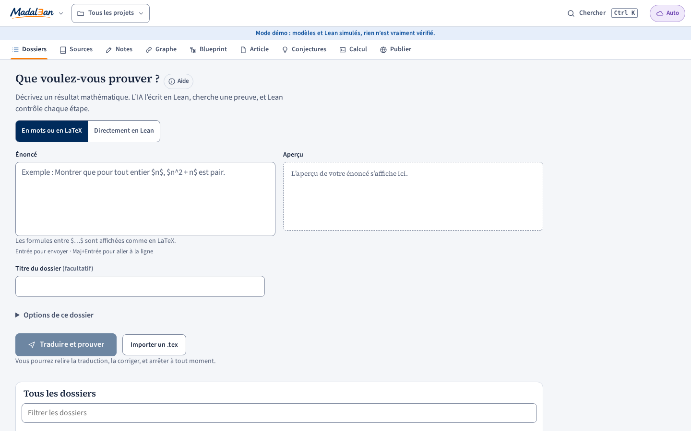

# Manuel de Madalean

Madalean est un assistant de démonstration pour **Lean 4** et **Mathlib**. Vous écrivez un énoncé en langage
courant (formules LaTeX entre dollars acceptées), des modèles d'IA le traduisent en Lean, cherchent une preuve et
l'expliquent ; **Lean tranche**. Rien n'est jamais présenté comme prouvé si Lean ne l'a pas accepté selon le verdict
strict : aucune erreur, aucun `sorry`, aucun axiome autre que les trois axiomes standard de Lean
(`propext`, `Classical.choice`, `Quot.sound`).

Un seul ordinateur, l'**ordinateur hôte**, fait tout le travail : Lean, modèles locaux, stockage. Tous les écrans
(cet ordinateur, un autre PC, une tablette, un téléphone) affichent la **même interface web** et restent
synchronisés. Les appareils joignent l'hôte uniquement par votre réseau privé Tailscale.

## Ce que Madalean ne fait pas

- Il ne garantit pas que la traduction en Lean dit ce que vous vouliez dire. Lean vérifie la preuve **de l'énoncé
  Lean**, pas de votre phrase. Relisez toujours la traduction : voir [Lire un énoncé Lean](reading-lean.md).
- Il ne trouve pas toutes les preuves. « Pas de preuve trouvée » ne veut pas dire que l'énoncé est faux.
- Il n'envoie rien sur Internet en mode **Local**. Dans les autres modes, ce qui part et vers qui est décrit dans
  [Modèles et clés](models-keys.md).

## Plan du manuel

- **Démarrer** : [Installer Madalean](install.md) · [Ce qu'installe Madalean](components.md) ·
  [Première configuration](first-config.md) · [Premier démarrage](first-run.md) ·
  [Relier un téléphone, une tablette, un PC](pairing.md) · [Tailscale](tailscale.md)
- **Travailler** : [De l'énoncé à la preuve](workflow.md) · [Lire un énoncé Lean](reading-lean.md) ·
  [Demandes de suivi et versions](follow-ups.md) · [Projets et dossiers en parallèle](projects.md) ·
  [Plans de preuve et lemmes](proof-plans.md)
- **Recherche** : [Atelier de conjectures](conjectures.md) · [Sources et questions ancrées](sources.md) ·
  [Bibliographie, article, blueprint](articles.md) · [Notes](notes.md) · [Jupyter et Sage](jupyter.md) ·
  [Publier un projet](publish.md)
- **Réglages et sécurité** : [Modèles et clés](models-keys.md) · [Mises à jour](updates.md) ·
  [Sécurité](security.md)
- **Référence** : [Dépannage](troubleshooting.md) · [Glossaire Lean](glossary.md) ·
  [Premières tactiques](tactics.md) · [Raccourcis clavier](shortcuts.md)

## Conventions de ce manuel

- Les noms entre guillemets (« Envoyer », « Réglages › Appareils ») sont ceux des boutons et menus de l'interface.
- Les blocs de code `lean` sont du Lean 4 avec Mathlib. Ils suivent la version de Mathlib de l'espace de travail
  « Prouveur » (Lean 4.9) sauf mention contraire ; quelques notations ont changé depuis, elles sont signalées.
- Les pages marquées *apprenant* s'adressent à qui découvre Lean ; *chercheur* à qui l'utilise pour un projet de
  recherche. La plupart concernent tout le monde.
