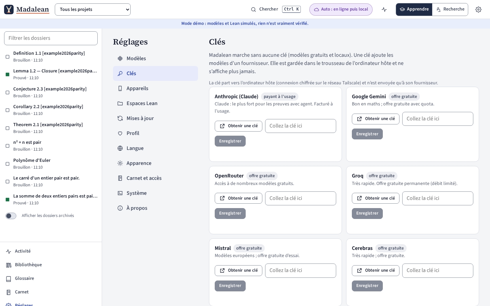

# Modèles et clés

Madalean fonctionne **sans aucune clé** : modèles locaux installés sur l'hôte et fournisseurs en ligne gratuits sans
compte. Une clé ajoute les modèles d'un fournisseur, souvent plus forts.

## Les trois modes

| Mode | Qui travaille | Réseau |
|---|---|---|
| *Local* | seulement les modèles de l'ordinateur hôte (Goedel-Prover, Goedel-Formalizer, Qwen3, et Ollama s'il tourne) | rien ne quitte l'hôte ; toute connexion non locale est refusée avant d'être ouverte |
| *Automatique* (défaut) | les modèles en ligne (avec un jeton Hugging Face, Goedel-Prover 32B ouvre chaque preuve) | les modèles locaux **seulement** sans Internet, ou quand aucun modèle en ligne ne peut travailler (tous en panne, en pause ou refusés) ; sinon le modèle local n'est pas chargé et la carte graphique reste libre |
| *En ligne* | uniquement des modèles en ligne | sans réseau, le travail échoue avec un message clair |

Madalean distingue « pas d'Internet » (une sonde rapide, mise en cache) d'un « fournisseur en panne » (Internet
répond mais pas lui) : sans Internet, il passe aussitôt aux modèles locaux ; un fournisseur en panne est seulement
sauté pendant une minute. En mode *Automatique*, une preuve que les modèles en ligne ont cherchée sans la trouver
n'est **pas** relancée sur le modèle local (le Goedel 32B en ligne est plus fort que le 8B local).

Pour un dossier précis, « Options de ce dossier » (sur l'accueil) permet de choisir un autre mode que le mode
général. L'indicateur en haut de l'écran
(« Qui reçoit quoi ») dit à chaque instant quel modèle reçoit votre travail. Chaque texte produit par un modèle
indique son nom.

## Ce qui part, et vers qui

| Étape | Ce que reçoit le modèle |
|---|---|
| Compréhension | votre énoncé en langage courant |
| Traduction en Lean | votre énoncé et sa reformulation |
| Preuve | l'énoncé Lean, les messages d'erreur de Lean, des lemmes de Mathlib trouvés pour l'énoncé |
| Explication, preuve rédigée | l'énoncé et la preuve Lean |
| Questions sur les sources | votre question et les passages retenus de vos sources |
| Calcul (cellule « Demander ») | votre demande et les noms déjà définis dans le carnet (pas les sorties complètes) |

Ce qui n'est **jamais** envoyé à un modèle : vos clés d'API, vos jetons d'appareils, vos autres dossiers, vos
fichiers. Une clé n'est envoyée qu'à **son** fournisseur : Madalean refuse de joindre une clé à une adresse qui n'est
pas celle de ce fournisseur.

Les fournisseurs gratuits sans compte livrés avec Madalean (LLM7.io, OVHcloud AI Endpoints, Kilo Code,
Pollinations) appliquent leurs propres conditions ; supposez que ce que vous leur envoyez peut être conservé. Pour un
travail confidentiel, utilisez le mode *Local*.

## Ajouter une clé

« Réglages › Fournisseurs » range les services en ligne par usage, avec ce qui est gratuit et où partent vos
données. Sur la carte d'un fournisseur, « Créer une clé » ouvre sa page de clés ; collez la clé, Madalean la
**teste aussitôt** (« Ça marche : N modèles disponibles », ou la
raison du refus). La clé est gardée dans le trousseau de l'ordinateur hôte (sinon dans un fichier lisible par vous
seul) et ne s'affiche plus jamais. « Retirer la clé » la supprime en un clic.

### Clé Anthropic (Claude)

1. Sur la carte Anthropic, « Créer une clé » ouvre la page des clés de la console d'Anthropic ; créez un compte si
   besoin.
2. Claude est payant à l'usage : suivez les indications d'Anthropic pour ajouter un moyen de paiement ou des
   crédits.
3. Créez une clé et copiez-la (elle commence par `sk-ant-`). Elle n'est en général montrée qu'une fois.
4. Collez-la sur la carte Anthropic.

Conseil : si la console d'Anthropic le permet, fixez-y aussi une limite de dépense ; Madalean a de toute façon ses
propres plafonds (voir plus bas).

### Clé Google Gemini

1. Sur la carte Google Gemini, « Créer une clé » ouvre la page des clés de Google AI Studio (avec un compte
   Google).
2. Créez une clé et copiez-la.
3. Collez-la sur la carte Google Gemini.

L'offre gratuite de Gemini a des quotas ; quand ils sont atteints, Madalean passe au modèle suivant. Les conditions
d'utilisation des données diffèrent selon l'offre et peuvent changer : lisez celles de Google avant d'envoyer un
travail non publié avec une clé gratuite.

### Jeton Hugging Face (Goedel-Prover 32B en ligne)

Avec un jeton Hugging Face, **Goedel-Prover-V2-32B** (servi en ligne par un fournisseur partenaire d'Hugging
Face) ouvre chaque preuve : c'est la même boucle que le Goedel local — mêmes prompts, ≤ 2 corrections par
piste, mêmes réglages d'échantillonnage —, avec le modèle 32B au lieu du 8B, sans occuper la carte graphique. S'il
échoue, les modèles gratuits prennent le relais (tournoi). Le Goedel-Formalizer est utilisé de même dès qu'un
fournisseur le sert en ligne.

1. Créez un compte sur le site de Hugging Face (`huggingface.co`). Les appels sont payés avec des crédits Hugging Face (les
   conditions de l'offre sont sur le site d'Hugging Face).
2. Sur la carte Hugging Face, « Créer une clé » ouvre la page des jetons d'Hugging Face, prête à créer un jeton avec
   la permission « Make calls to Inference Providers » ; créez le jeton (il commence par `hf_`).
3. Collez-le : Madalean vérifie le jeton (sans rien facturer) et dit si Goedel 32B est disponible en ligne.

Le jeton n'est envoyé qu'à `router.huggingface.co` (les calculs) et `huggingface.co` (la vérification du jeton).
La liste des modèles Goedel servis en ligne est lue sur l'API publique de Hugging Face, **sans** le jeton.
Désactivable dans « Réglages › Modèles › Réglages avancés » (« Goedel-Prover 32B en ligne (Hugging Face) ouvre
chaque preuve quand le jeton est enregistré »).

## Ce que cela coûte

Les fournisseurs payants facturent au nombre de *tokens* (≈ ¾ de mot) envoyés et reçus. Tarifs publics d'Anthropic
qu'utilise cette version de Madalean pour ses estimations, par million de tokens (entrée / sortie) ; les prix en
vigueur sont ceux du site d'Anthropic :

| Modèle | Entrée | Sortie |
|---|---|---|
| Claude Opus 5.5 | 4 $ | 20 $ |
| Claude Sonnet 5.5 | 2 $ | 10 $ |
| Claude Haiku 5.5 | 0,10 $ | 0,50 $ |

Le coût d'une preuve dépend de l'énoncé et du nombre d'essais ; il est borné par le plafond par preuve (voir plus
bas), et chaque appel payant est affiché avec son coût sous les plafonds. Les limites (étapes et durée de l'agent,
essais, durée d'une preuve) se règlent dans « Réglages › Modèles › Réglages avancés ». Un modèle payant n'est utilisé
que si vous l'avez choisi pour une tâche, ou en renfort (Claude, ci-dessous).

**Goedel-Prover 32B en ligne (Hugging Face).** Le fournisseur ne publie pas de prix par jeton pour ce modèle :
Madalean utilise une **estimation prudente** de 1,00 $ (entrée) / 3,20 $ (sortie) par million de tokens, remplacée
par le prix publié dès qu'Hugging Face en donne un. Une tentative Goedel (jusqu'à 32 768 tokens de réponse) coûte donc
au plus ≈ 0,11 $ ; les 4 tentatives du premier round d'une preuve, au plus ≈ 0,45 $. Le coût réel se voit dans
l'espace de facturation de votre compte Hugging Face.

## Claude en renfort payant, avec plafonds

Avec une clé Anthropic, Claude peut entrer **en dernier** dans le tournoi d'une preuve, seulement quand les modèles
gratuits ont tous échoué (« Réglages › Modèles », partie « Claude en renfort payant », case « Faire appel à Claude
quand les modèles gratuits échouent », cochée par défaut).
Deux plafonds, modifiables au même endroit :

- « Plafond par preuve » (1,00 $ par défaut) ;
- « Plafond par mois », par mois civil (20 $ par défaut), pour tous les appels payants — Claude, y compris dans un rôle où vous l'avez
  choisi, et Goedel en ligne sur Hugging Face (mêmes plafonds, même registre).

Avant chaque appel, Madalean estime le coût au tarif public (taille de la demande et longueur de réponse permise) et
réduit la longueur de réponse si besoin ; si même une réponse courte dépasserait un plafond, l'appel **n'est pas
fait** et la preuve le signale. Après l'appel, le coût réel est calculé d'après l'usage renvoyé par Anthropic (jetons
d'entrée, de sortie, lus et écrits en cache) et noté dans un petit registre privé de l'hôte. Le total du mois
(« Dépensé en … ») et les derniers appels sont affichés sous les plafonds. Ce total est calculé au tarif public : la
facture d'Anthropic fait foi.

## Choisir un modèle par rôle

« Réglages › Modèles », partie « Modèle par tâche », montre, pour chaque tâche (comprendre l'énoncé, traduire en
Lean, prouver, expliquer, assistant…), le classement des modèles disponibles et la raison du classement
(« Pourquoi ? »). « Automatique » laisse le routeur choisir ; vous pouvez imposer
un modèle. Un modèle en erreur (quota, clé refusée, surcharge) est mis en pause et le suivant prend le relais.
