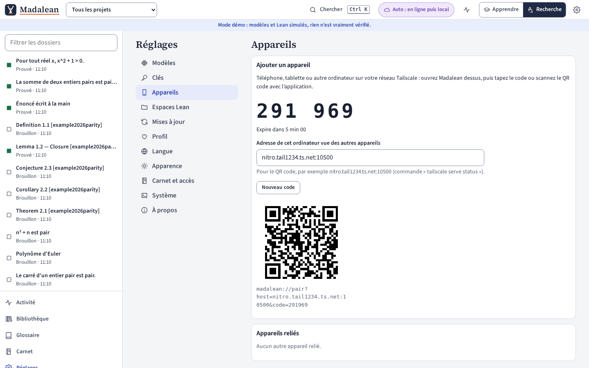
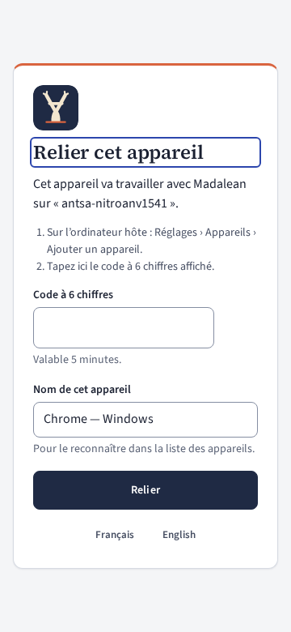

# Relier un téléphone, une tablette ou un autre PC

Un appareil relié affiche la même interface que l'ordinateur hôte et reste synchronisé avec lui : ce que vous
lancez au téléphone apparaît sur le PC, et inversement. Tout le calcul reste sur l'hôte.

Il faut trois choses :

1. l'ordinateur hôte allumé, Madalean démarré ;
2. l'hôte et l'appareil sur **votre réseau Tailscale** (voir [Tailscale](tailscale.md)) ;
3. un **code à 6 chiffres** affiché par l'hôte.

Sur l'ordinateur hôte lui-même, aucun code n'est nécessaire.

## Étape 1 — Publier Madalean sur votre réseau Tailscale (une fois)

Sur l'hôte, dans le dossier de Madalean :

```bash
scripts/tailscale_setup.sh
```

Le script ajoute **une seule** règle, `tailscale serve --bg --https=10500 http://127.0.0.1:11501`, et affiche
l'adresse de l'hôte vue des autres appareils, de la forme `https://nom-du-pc.tailXXXX.ts.net:10500`. Il ne touche
à aucune autre règle `tailscale serve` de la machine et n'active jamais *Funnel* (l'ouverture sur Internet).
`scripts/tailscale_setup.sh --print` montre les commandes sans rien changer ; `--remove` retire la règle.

Si le script signale que HTTPS n'est pas activé, suivez [Tailscale › Activer HTTPS](tailscale.md#activer-https).
<!-- verify after integration: tailscale_setup.sh applied for real on the host; printed URL format -->

## Étape 2 — Afficher un code sur l'hôte

Sur l'ordinateur hôte : « Réglages › Appareils › Ajouter un appareil ». Un code à 6 chiffres s'affiche, valable
**5 minutes**, utilisable **une seule fois**, avec un QR code pour l'application Android.



Vérifiez le champ « Adresse de cet ordinateur vue des autres appareils » : c'est l'adresse affichée par le script de
l'étape 1, sans `https://` (par exemple `nitro.tail1234.ts.net:10500`). Elle sert à fabriquer le QR code.

## Étape 3 — Sur l'appareil

### Téléphone ou tablette Android

1. Installez l'application **Tailscale** (Play Store) et connectez-vous avec **le même compte** que sur l'hôte.
2. Installez l'application **Madalean** depuis la [page d'installation](site:install) (fichier APK ; Android
   demande d'autoriser l'installation depuis votre navigateur, une fois).
3. Scannez le QR code de l'hôte avec l'appareil photo : l'application s'ouvre avec l'adresse et le code déjà
   remplis. Sinon, tapez l'adresse et le code à la main.
4. Donnez un nom à l'appareil (« Pixel de Marie ») et touchez « Relier ».



### iPhone, iPad, ou tout appareil avec un navigateur

Il n'y a pas d'application iOS. Installez Tailscale (App Store), puis ouvrez dans le navigateur l'adresse
`https://nom-du-pc.tailXXXX.ts.net:10500`. La page de liaison demande le code et un nom d'appareil.
Astuce : « Partager › Sur l'écran d'accueil » donne une icône qui ouvre Madalean directement.
<!-- verify after integration: browser pairing over the tailnet from Safari; cookie persists -->

### Autre ordinateur Linux

Installez Tailscale, puis soit un navigateur (comme ci-dessus), soit l'application de bureau **Madalean**
(AppImage, [page d'installation](site:install)) qui garde le jeton dans le trousseau du système et se reconnecte
seule.

## Ce qui se passe au moment de la liaison

L'appareil envoie le code ; l'hôte lui remet un **jeton** secret (256 bits) qui l'identifie ensuite. L'hôte ne garde
qu'une empreinte de ce jeton, jamais le jeton lui-même. Cinq codes faux d'affilée bloquent la liaison 10 minutes.
Détails : [Sécurité](security.md).

## Délier un appareil

- Depuis l'hôte : « Réglages › Appareils », bouton « Délier » en face de l'appareil. L'accès est coupé
  **immédiatement**, y compris pour une page déjà ouverte.
- Depuis l'appareil lui-même : « Réglages › Appareils › Délier cet appareil ».

Délier un téléphone perdu est la première chose à faire ; votre compte Tailscale permet aussi de retirer l'appareil
du réseau privé.

## Si ça ne marche pas

| Message | Que faire |
|---|---|
| « Code incorrect » | Retapez les 6 chiffres affichés sur l'hôte. |
| « Ce code a expiré » | « Nouveau code » sur l'hôte (validité 5 minutes). |
| « Trop d'essais : la liaison est bloquée N min » | Attendez, puis demandez un nouveau code. |
| L'adresse ne répond pas | Tailscale est-il connecté sur les deux appareils ? Voir [Dépannage](troubleshooting.md#lappareil-ne-joint-pas-lhote). |
