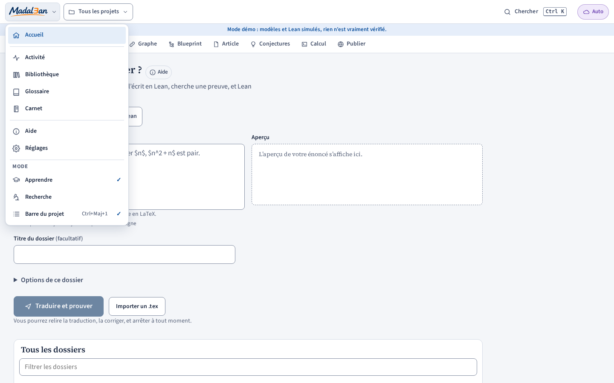
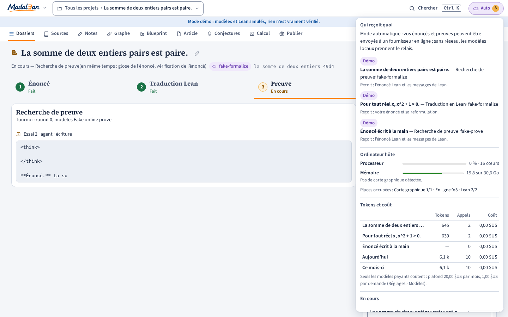

# Projets et dossiers en parallèle

## Se repérer

Tout se trouve au même endroit sur un ordinateur, une tablette ou un téléphone :

- **Le logo Madal∃an**, en haut à gauche, ouvre le menu : « Accueil » en premier, puis Activité, Bibliothèque,
  Glossaire, Carnet, Aide, Réglages, le choix *Apprendre* / *Recherche* et la barre du projet. Un second clic sur
  le logo, menu ouvert, ramène à l'accueil.
- **Le nom du projet** (et, dans un dossier, celui du dossier) à côté du logo est le seul endroit où l'on change de
  projet ou de dossier : à gauche les projets (« Nouveau projet… », « Vue d'ensemble du projet »), à droite les
  dossiers du projet choisi, avec leur état. Les noms sont écrits en entier.
- **La barre du projet**, sous la barre du haut : Dossiers · Sources · Notes · Graphe · Blueprint · Article ·
  Conjectures · Calcul · Publier. `Ctrl+Maj+1` la masque ou la remet.
- **Le bouton d'état**, en haut à droite (nuage : en ligne ; puce : local) : le mode, le modèle qui reçoit votre
  travail, les ressources de l'ordinateur hôte (processeur, mémoire, carte graphique), les tokens et le coût
  (cette demande, aujourd'hui, ce mois-ci), les travaux en cours. Ces mesures ne sont prises que panneau ouvert.

Un menu ou un volet se ferme d'un clic ailleurs ou avec `Échap`. **Tout s'enregistre tout seul** : titre et énoncé
d'un dossier, notes, article, cellules de Calcul, code des expériences, plan, description du projet, réglages. Un petit
« Enregistré » le confirme ; « Non enregistré — réessai » signale un problème de réseau (Madalean réessaie, votre
texte reste à l'écran).

## Projets

Un **projet** regroupe des dossiers : un chapitre de cours, un article en préparation, une série d'exercices. Le
nom du projet en haut à gauche (« Tous les projets ») permet d'en choisir un ; la page « Dossiers » montre alors ses
dossiers. Un projet a son espace Lean, sa bibliographie, ses sources, ses notes, son plan d'article ; son titre et
sa description se modifient sur sa page (« Vue d'ensemble du projet »).

Supprimer un projet le met à la corbeille : « Annuler » le restaure. Ses dossiers ne sont pas supprimés.

## Plusieurs dossiers à la fois

Vous pouvez lancer autant de dossiers que vous voulez ; ils avancent en parallèle, limités par les ressources de
l'hôte :

| Ressource | Places | Utilisée par |
|---|---|---|
| carte graphique | 1 | un modèle local à la fois (Madalean change de modèle selon l'étape) |
| en ligne | 3 | appels aux modèles en ligne |
| Lean | 2 | compilations |

Un travail n'attend que la ressource de l'étape en cours ; vos travaux passent avant les relances automatiques.
L'écran « Activité » montre ce qui tourne, ce qui attend et pourquoi (« en attente : carte graphique »).

Un dossier n'a qu'un travail actif à la fois ; une nouvelle demande sur un dossier occupé est refusée avec un
message clair. Tout travail s'arrête à la demande.

## Sur tous les appareils

Tous les appareils reliés voient les mêmes projets, les mêmes dossiers et les mêmes travaux en direct. Lancez une
preuve depuis le téléphone, suivez-la sur le PC. Après une coupure réseau, l'appareil se resynchronise seul.

## Espaces Lean

Chaque projet utilise un **espace de travail** Lean (« Réglages › Espaces Lean ») :

- *Prouveur* : Lean 4.9 et la Mathlib d'entraînement des modèles Goedel. Épinglé : il n'est jamais mis à jour,
  pour que les modèles locaux restent efficaces.
- *Lean actuel* : dernière Mathlib, mise à jour automatiquement (voir [Mises à jour](updates.md)).

Un résultat de la bibliothèque n'est réutilisable que dans l'espace où il a été prouvé.
