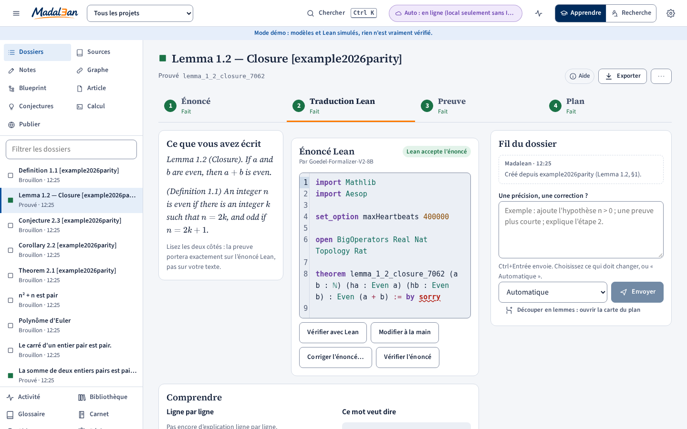

# De l'énoncé à la preuve

Chaque problème vit dans un **dossier**. En haut de l'écran, quatre étapes disent où vous en êtes :
**Comprendre › Traduire › Prouver › Vérifier**, chacune « pas commencé », « en cours », « vous attend », « fait » ou
« échec ». Juste dessous, une seule ligne **« En ce moment »** dit ce que fait Madalean, le numéro de l'essai, le
modèle, depuis combien de temps et ce qui tourne à côté ; « Arrêter » est toujours là. Si c'est à vous de répondre,
elle le dit et vous y mène ; en cas d'échec, elle mène à ce qui a été essayé, à la dernière cause et aux suites possibles.

Au centre, le **fil** raconte tout dans l'ordre : vos demandes, puis chaque phase, ses essais (repliés), les réponses
des modèles en direct, les sous-dossiers là où ils ont été créés. Des filtres montrent seulement vos demandes, les
résultats, les contrôles ou les essais. Le champ du bas dit **à propos de** quoi porte votre demande.

À côté, le **volet** garde les références : Énoncé, Lean, Preuve, Sous-lemmes (arbre, plan et graphe), Littérature,
Calculs, Versions. « Séparer » met une partie dans sa propre fenêtre ou dans une colonne, « Remettre » la ramène. Le
volet se redimensionne et se masque ; sur téléphone, le bouton « Références » l'ouvre par-dessus le fil.

### Vos deux accords

Avant toute preuve, Madalean vous montre ce qu'il a **compris** (texte reformulé, objets, hypothèses, affirmation, ce
qu'on en sait avec les citations), puis l'**énoncé Lean** avec sa relecture en langage courant. Pour chacun :
« Approuver », « Corriger » ou « Refuser ». « Lean comprend le code » ne veut dire ni « fidèle » ni « prouvé ». Un
problème ouvert est annoncé comme tel ; les résultats connus autour deviennent des sous-dossiers qu'une seule carte
permet d'approuver. Le statut « d'après un modèle, à vérifier » n'a pas de référence.

### « Mal compris »

Sur le sens, l'énoncé, la preuve ou un message, « Mal compris » signale une mauvaise interprétation : une raison, un
mot d'explication, et l'étape est refaite avec votre remarque.

## 1. Écrire l'énoncé

Écrivez avec vos mots, en français ou en anglais. Les formules LaTeX entre dollars sont lues : `$a^2+b^2 \ge 2ab$`.
Un aperçu montre comment l'énoncé sera compris. Vous pouvez aussi :

- **importer un fichier `.tex`** : Madalean en extrait les environnements de type théorème et vous choisissez
  lequel prouver ;
- **coller directement un énoncé Lean** : l'étape de traduction est alors sautée.

Un énoncé précis se traduit mieux : nommez les ensembles ($n \in \mathbb{N}$, $x \in \mathbb{R}$), les hypothèses
et la conclusion.

## 2. La traduction en Lean

Un premier modèle reformule votre demande en énoncé mathématique précis (« théorème de la base incomplète » devient
« toute famille libre d'un espace vectoriel de dimension finie se complète en une base »). Un second la traduit en
Lean ; **Lean vérifie que l'énoncé est bien formé** avant d'aller plus loin. La mention « Lean comprend le code »
signifie seulement que l'énoncé a un sens pour Lean, pas qu'il est vrai, ni qu'il dit ce que vous vouliez.

**Relisez cette traduction.** C'est le seul point où une erreur passe inaperçue : Lean prouvera exactement l'énoncé
Lean. Les pièges courants (division entière, soustraction tronquée sur $\mathbb{N}$, division par zéro) sont dans
[Lire un énoncé Lean](reading-lean.md). En mode *Apprendre*, le panneau « Comprendre » explique l'énoncé ligne par
ligne et chaque mot Lean au survol.

Pour corriger : « Modifier à la main » (vous éditez le code, Lean le revérifie), ou « Corriger l'énoncé… » (vous
décrivez la correction, le modèle réécrit).

## 3. La preuve

Madalean cherche une preuve selon la méthode choisie dans « Réglages › Modèles » :

| Méthode | Fonctionnement |
|---|---|
| *goedel* | le modèle local Goedel-Prover écrit une preuve ; si Lean la refuse, il lit l'erreur et corrige, plusieurs fois |
| *agent* | un modèle qui sait utiliser des outils compile lui-même des essais avec Lean et cherche des lemmes dans Mathlib |
| *auto* (défaut) | agent avec le meilleur modèle en ligne autorisé, sinon goedel ; goedel aussi en secours si l'agent échoue |

Quelle que soit la méthode, la preuve finale est **revérifiée par le serveur** avec le verdict strict. Le badge
« Preuve vérifiée par Lean » donne la version de Lean, la révision de Mathlib, la durée, le nombre d'essais, le
modèle qui l'a écrite et les axiomes utilisés.

Pendant la recherche, le texte des modèles arrive en direct à la fin du fil, avec chaque essai compilé. « Arrêter » coupe
tout, à tout moment (requête au modèle et compilation Lean).

En mode *Apprendre*, la preuve n'est pas montrée tout de suite : une échelle d'indices (coup de pouce, stratégie,
lemme clé, étape suivante, preuve complète) vous laisse chercher d'abord. Le dernier niveau est toujours la preuve
vérifiée par Lean, jamais un texte de modèle.

## 4. L'explication

Une fois la preuve acceptée, un modèle l'explique en langage courant et rédige une **preuve en langage naturel**
(celle qui ira dans le PDF). Ces textes sont des brouillons modifiables : vous pouvez les corriger à la main, et une
modification manuelle n'est jamais écrasée sans votre accord.

## 5. Exporter

« Exporter » propose :

| Format | Contenu |
|---|---|
| PDF | titre, énoncé en langage naturel, énoncé Lean et sa glose, preuve rédigée, preuve Lean, tampon de vérification (version de Lean, révision de Mathlib, date, axiomes, modèle), explication tactique par tactique en annexe |
| LaTeX (`.tex`) | le même document, à compiler avec XeLaTeX (par exemple sur Overleaf) |
| Lean (`.lean`) | le fichier qui compile |
| Markdown (`.md`) | texte et formules `$…$` |
| Tout (`.zip`) | tout cela, avec `refs.bib` si le dossier cite des sources |

Un dossier non prouvé est exporté avec la mention « Non prouvé » et sans tampon. Si aucun moteur TeX n'est installé
sur l'hôte, Madalean ouvre une version HTML : utilisez « Imprimer › Enregistrer en PDF » du navigateur.

## Et ensuite

- Affiner : [Demandes de suivi et versions](follow-ups.md).
- Plusieurs résultats liés : [Projets et dossiers en parallèle](projects.md).
- Un résultat trop gros pour une seule preuve : [Plans de preuve et lemmes](proof-plans.md).
- Chaque résultat prouvé entre dans la **Bibliothèque** et sert de lemme aux preuves suivantes du même espace Lean.
